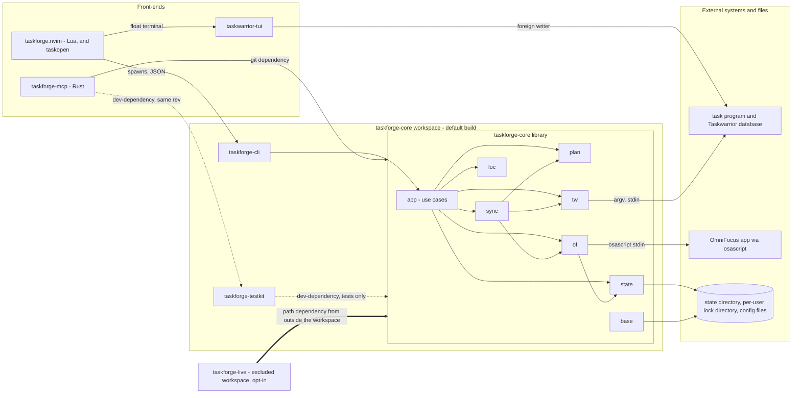
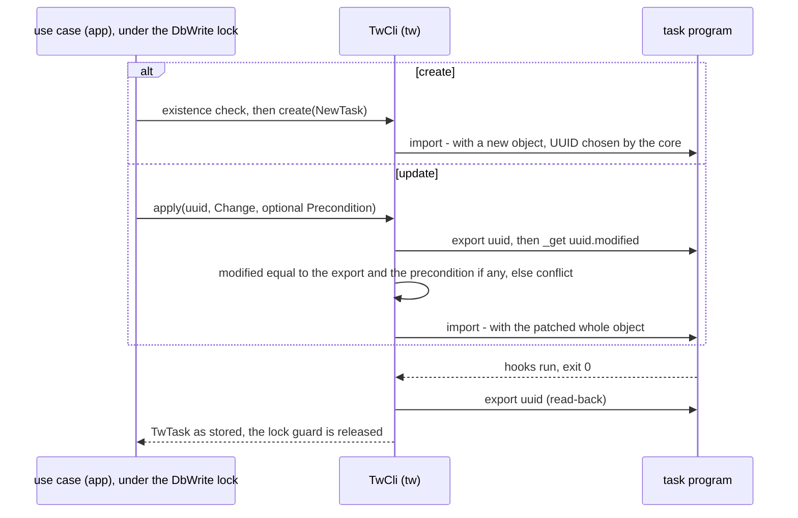
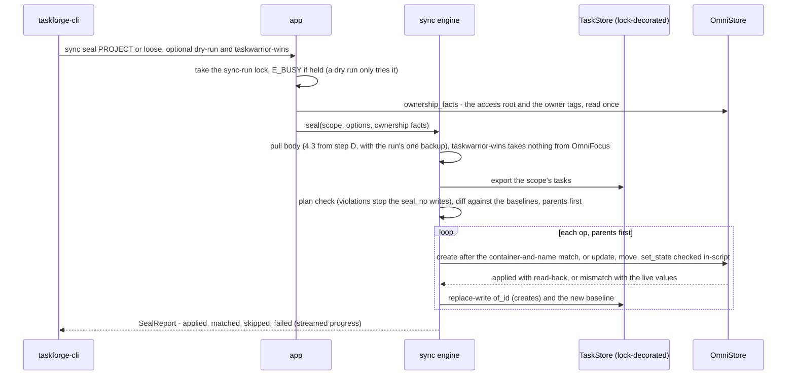
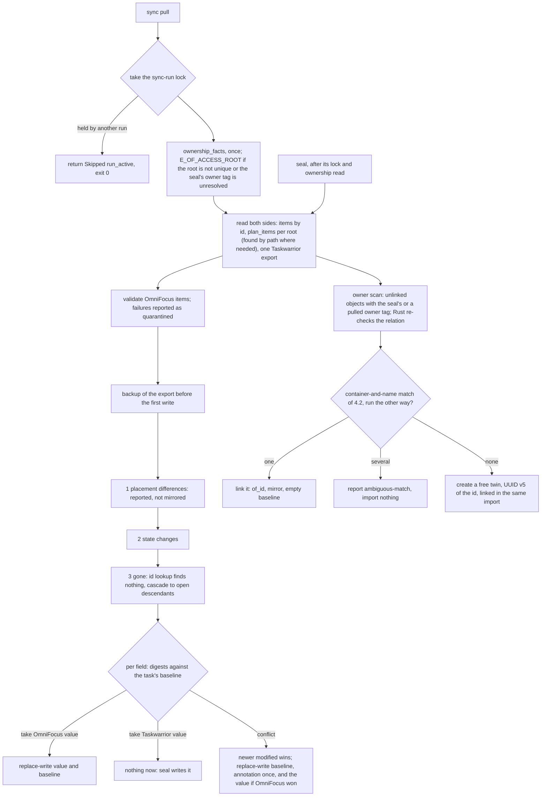
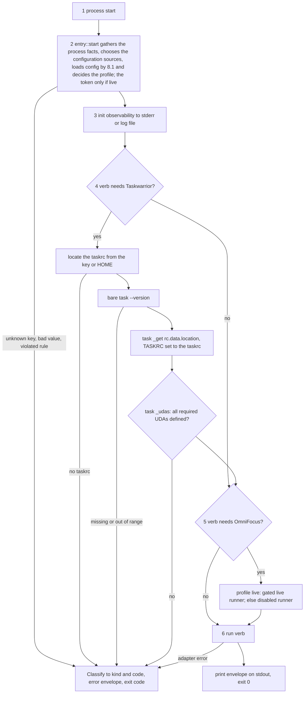

# taskforge — Architecture

Status: converged design. Scope: the taskforge system as a whole. The core (`taskforge-core`, a Rust workspace) is the
main subject; the MCP server (`taskforge-mcp`) and the Neovim plugin (`taskforge.nvim`) are consumers, described to the
depth their boundaries with the core require.

Evidence conventions. Statements about existing code cite repo-relative files and symbols of `taskforge-mcp` at branch
`feat/http-transport` (head `ecd5e13`) and at branch `dev` (head `ccf8ec4`), the two lines whose merge the extraction
starts from (6.6), and of `taskforge.nvim` at branch `dev` (head `baf94af`); where the two `taskforge-mcp` lines differ,
the statement names the commit. A statement marked **measured** was obtained by running `task` 3.5.0, Neovim, clang,
cargo or JavaScriptCore on macOS against throwaway directories (never a real database) and has its command in Appendix A
(`docs/architecture/appendix-a-facts.md`), the fact corpus (`TW…` for Taskwarrior, `X…` for everything else).
OmniFocus's scripting interface is quoted from *OmniFocus's API reference*: the `OmniFocusModel-Interfaces.strings` file
of the OmniFocus 4.9.3 app bundle, the text the Omni Automation reference (<https://omni-automation.com/omnifocus/>) is
generated from, read from disk. Times carry the load average at which they were taken; no rule depends on an absolute
time. A statement that rests on documentation or reasoning only is marked **assumed** and listed in 10.3. Appendix D
(`docs/architecture/appendix-d-api.md`) sketches the library API. Detail that belongs to a delivery phase's PRD (test
names, refusal texts, step choreography) is listed once, in 10.5.

### Document map

| If you want to know … | Read |
| --- | --- |
| what the system is, which style, what is fixed | 1, 2 |
| which crate and module owns what | 3 |
| how data moves: write, seal, pull, locate code, start up | 4 |
| what is stored, the sync metadata and merge, plan model and scheduling | 5; facts and timings: Appendix A |
| contracts: library API, CLI JSON, adapters, MCP (6.4–6.6 for `taskforge-mcp`), editor (6.7, 6.8 for `taskforge.nvim`) | 6; API signatures: Appendix D |
| configuration, errors, locks, security, the live profile and the live crate | 8 |
| file layout, size budgets, delivery phases | 9 |
| decisions, risks, open and deferred items, PRD notes | 7, 10 |

### Glossary

| Term | Meaning (used with this meaning everywhere) |
| --- | --- |
| Taskwarrior (TW), `task`; OmniFocus (OF) | the task manager and its command-line program, version 3.5.x; the task manager app on macOS/iOS, reached only by scripting the Mac app |
| Upstream / Downstream | work done in Taskwarrior / work done in OmniFocus; never used for the origin of a fork (see "original project") |
| original project | the MIT-licensed project `taskforge-mcp` was forked from |
| plan, plan root | the dated breakdown of one project (phase → milestone → task → subtask); its plan root is the Taskwarrior `project:` path its plan nodes carry (5.5) |
| kind, level | `kind` (`plan`, `code`, `free`) classifies a task; `level` (`phase`, `milestone`, `task`, `subtask`) positions a plan node. A bare "phase" is always a plan level; a step of 9.4 is always a *delivery phase* |
| seal, seal scope, pull | the explicit command that writes a plan, or the loose links, Downstream as a minimal diff (4.2); what one seal carries: one plan root, or `--loose`; reading OmniFocus changes into Taskwarrior, never writing OmniFocus (4.3) |
| link, twin; holds, linked | a *link* pairs a Taskwarrior task with an OmniFocus object: the object's id stands in the task's `of_id` attribute; each side's object is the other's *twin* (5.5). A task *holds* the id in its `of_id`, whatever its status; it is *linked* when it holds one and is not flagged `unlinked`; an object is *unlinked* when no task holds its id (the object of a task flagged `unlinked` is still held) |
| crossing field, baseline | a field synchronised between the two stores (5.4); the per-field digests of what each side held when the two last agreed, in the task's `sync_base` attribute (5.5) |
| report code, dismissal | a condition a sync run reports (`tw-moved`, `ambiguous-match`, …), recomputed by every run; a *dismissal* is a code recorded in the task's `sync_dismissed` attribute, which silences it for that task; the same attribute carries the flag `unlinked` (5.5) |
| operation export, backup | the immutable result of one `export`, reused within one operation; a *backup* is the Taskwarrior export a writing run (5.9) takes before its first write |
| write lock, lock guard, precondition, existence check | the `DbWrite` file lock of 8.8; the RAII value releasing a lock; the expected `modified` the caller saw; the query that a UUID is absent before a create |
| gate, gate hold | the per-user cross-process lock taken for every OmniFocus script (8.8); a *hold* keeps it across the scripts of one MCP call |
| nexus, boundary component | the single non-optional home of a cross-cutting concern (8); the only taskforge code that talks to one external system (A1) |
| access root, owner tag, pulled owner tag | the top-level OmniFocus tag `access`; a direct child of it (`access/agent`), never a tag below one (6.5); an owner tag `sync.pull_owner_tags` lists (4.3, 8.1). A linked task records its object's owner tag once, as information, under `access.` (5.5) |
| user | the human who owns the machine account, the taskrc and both databases, and runs the CLI and the editor; every OmniFocus object without an owner tag is the user's. An agent is never the user |
| agent client, client, owned tags, narrow, global | a program driven by an AI agent that reaches OmniFocus through the MCP: over stdio unrestricted (FD7), over HTTP a *client* of the ownership model, the holder of one server's bearer token. Its *owned tags* are the owner tags its connector entry lists; its kind (`mcp.access`) is *narrow* or *global* (6.5) |
| own, path, foreign, untagged | an object's relation to one client, defined once in 6.5: own (one owner tag, the client's), foreign (another one, or two or more, the root, unreadable tags), untagged (none: the user's); *path* is a folder a narrow client sees by name on the way to its own projects |
| admission nexus, admission probe, start set, visible set | the one home of every ownership decision for HTTP clients (6.5); the read that gathers the facts it decides on (6.4); the objects a narrow read starts from: those carrying the client's owned tags; what `SOURCE` binds for a narrow client, among which its identifiers resolve: the start set, the folders on its projects' paths, the owned tags and the tags those objects carry (6.5) |
| profile, live profile, sandbox, live-profile condition | the run's classification, decided by the rule of 8.10; the only profile allowed to reach the user's OmniFocus; every other run; one of LP1–LP5 of 8.10 |
| launcher channel, connector entry, MCP host | how the MCP server's settings arrive (8.1); the host's configuration of one server (program, arguments, environment); the agent application that launches it |
| hermetic environment | `HOME`, `XDG_CONFIG_HOME`, `XDG_DATA_HOME`, `XDG_STATE_HOME`, `XDG_CACHE_HOME`, `TASKRC` and `TASKDATA` all in one throwaway directory; built by `HermeticEnv` and the plugin's `tests/run.sh` (8.10) |
| live runner, gated runner, live crate | the runner of the real `osascript`, built only from a live token; that runner behind the gate (6.4); the separate cargo workspace `live/` of opt-in scenarios against the real OmniFocus (8.11) |
| marker, anchor; UDA, JXA, OmniJS, MCP, PRD | the text `[task:<uuid>]` in a source comment, and one located marker; Taskwarrior user-defined attribute; the macOS scripting dialect run by `osascript`; the OmniFocus automation JavaScript inside it; Model Context Protocol; the requirements document per delivery phase |
| envelope, script envelope | the CLI's one JSON output document (6.2); the OmniJS prelude in `of/runner/envelope.rs` that wraps every script and binds `SOURCE` (6.4, 6.5) |

---

## 1. Overview

### 1.1 What the system is

taskforge keeps one task model across three places where the user, or an agent acting for the user, works:

| Layer | Holds | Seen by |
| --- | --- | --- |
| Taskwarrior (Upstream) | the full breakdown: plan hierarchy, dependencies, estimates, code locations, user-defined attributes | agents, Neovim, the terminal |
| OmniFocus (Downstream) | the shared, higher-level items: project, phases, milestones, tasks | Mac, iPhone, iPad, other agents |
| Source code | `TODO:`-style comments carrying a `[task:<uuid>]` marker | the editor, `grep`, reviewers |

| Repository | Language | Role |
| --- | --- | --- |
| `taskforge-core` (new, Apache-2.0) | Rust workspace | domain model, Taskwarrior adapter, OmniFocus adapter, sync engine, plan scheduling, code locations, the `taskforge` CLI; the excluded live crate |
| `taskforge-mcp` (existing, forked from an MIT-licensed original project) | Rust | MCP tool schemas, transports (stdio, HTTP with bearer token), the ownership model for HTTP clients; links the core as a pinned git dependency |
| `taskforge.nvim` (existing, mid-refactor) | Lua | picker, embedded task UI, comment tracking, jump-to-location, dashboard; talks to the core only through the `taskforge` CLI |

### 1.2 Architectural style

**A small pure core with ports and adapters, two of which cross a process boundary.** The *domain* (task model, plan
hierarchy, merge rules, critical path, marker grammar, ownership relation) is pure Rust with no I/O. Each external
system sits behind exactly one *boundary component*: `task` behind the Taskwarrior adapter, OmniFocus behind the
OmniFocus adapter; third-party programs (the terminal, `taskwarrior-tui`) also write to Taskwarrior and the design
expects them (5.9). *Sync* is an explicit, trigger-driven engine with no state of its own: the link and the last agreed
values are attributes of the Taskwarrior task, and every run recomputes its work from the two live stores; there is no
daemon. Out-of-process consumers use the versioned JSON contract (`taskforge … --json`); the MCP server uses the library
API. Nothing else is a contract.

Why: both stores are owned by third-party programs whose behaviour can be measured but not changed, so the design
confines that dependence to two narrow places, passes untrusted text through a typed encoder there, and keeps the rest
deterministic and testable. Two working databases already exist, so a third would only add a copy to keep consistent. A
daemon, a plugin written in Rust and a direct storage-library integration were rejected (7).

### 1.3 Fixed decisions this architecture rests on

| # | Premise (decided; not an option) |
| --- | --- |
| FD1 | Taskwarrior is reached through the `task` CLI, not the `taskchampion` library; hooks must fire for writes |
| FD2 | One central Taskwarrior database; a repository's tasks are scoped by `project:` (dotted hierarchy); no per-project databases, registry or switching command |
| FD3 | Sync state is metadata on the tasks (link, last agreed values, dismissals as Taskwarrior attributes); the OmniFocus note is never touched. Field-level three-way merge; on a true conflict the newer `modified` wins and the loser's value is kept as an annotation; deletions drop, never purge. Restore is Taskwarrior's `undo` or a backup import, then a seal in which Taskwarrior wins (5.5) |
| FD4 | Downstream is written only when a plan is sealed, as a minimal diff; OmniFocus → core is polling (at start, on an event, on demand); no daemon; churn kept to the minimum |
| FD5 | Field map (name, note, due, defer ↔ `scheduled`, planned, flagged, estimate, tags with `/` ↔ `.`, project/folder path, state) as in 5.4; annotations, `details` and `teststrategy` stay Taskwarrior-only |
| FD6 | Code locations: marker `TODO: text [task:<uuid>]`, comment prefix per language, no stored line/column, the UUID is searched to place the cursor; several anchors per task allowed |
| FD7 | Ownership rules apply to OmniFocus over HTTP only; Taskwarrior is local and unrestricted and never served over HTTP |
| FD8 | Branding: `taskforge-core`, `taskforge.nvim`, `taskforge-mcp` |
| FD9 | The embedded task manager is `taskwarrior-tui`, styled from Neovim's colours; simple functions stay in the picker; required programs: `task`, `taskopen`, `taskwarrior-tui`, and OmniFocus when used |
| FD10 | Plan hierarchy: project → phase → milestone → task → subtasks (any depth), carried by UDAs plus `depends`; the parent link is the UDA `parent_uuid` (AD-17) |
| FD11 | Estimates are mandatory on generated tasks; a critical-path pass runs over `depends` and estimates; milestone deadlines are inputs, never computed; ties are reported, never resolved silently |
| FD12 | Three task kinds — `plan`, `code`, `free` — with the marker table of 5.6 |
| FD13 | Task generation (parse a PRD, expand, scope) belongs to the MCP, driven by the calling agent; generated tasks carry the owner tag `+access.agent` and never `of`; next-task and dependency order are native Taskwarrior |
| FD14 | The central database's location is whatever the user's single taskrc says; moving it is a manual step |
| FD15 | Sync never adds, removes or changes an owner tag on an existing OmniFocus object; objects created on seal get exactly the owner tag `access/agent`, the one generated tasks carry (FD13; one constant, `SEAL_OWNER_TAG` in `base/ownership.rs`); owner tags are changed in OmniFocus itself, because they decide what a remote client may reach |
| FD16 | Date model: tasks and milestones are deferred to their earliest start and carry a due date; the current phase carries a due date only (a planned date if it starts later); later phases carry an order only (5.7) |
| FD17 | HTTP clients follow the **ownership model**: each client has its own owned tags and is *narrow* (sees, changes and counts only its own objects) or *global* (reads everything; edits and completes own and foreign objects; deletes and drops only its own). An object without an owner tag is the user's, read-only to every client, and the user's projects, tasks and folders are closed to agents in both directions. No client changes ownership; tag writes are not served; a folder never mixes owners among its direct projects, the user counting as one; a narrow client never creates, renames, moves or deletes a folder; admission depends on ownership alone, never on an object's configuration (6.5) |

### 1.4 Non-goals

No daemon or file watcher; no Taskwarrior hook installation; no repository-wide comment scanning in the first release;
no TaskJuggler integration; no Taskwarrior over a network; no OmniFocus adapter outside macOS; no registry of MCP
clients (ownership is decided from each object alone).

---

## 2. Guiding Principles (Arch GP)

The chain is: global first principles → coding-domain first principles → the Arch GP below, each validated upward (it
refines, never contradicts, the chain). Global: `GP1` readability, `GP2` leverage and evidence, `GP3` best practice,
`GP4` documentation currency. Coding: `C1` test-first, tests in separate files; `C2` SOLID; `C3` a locked design is the
reference; `C4` anchored architecture (nexuses, single source of truth, configuration authored); `C5` map existing code
before redesigning it; `C6` minimal intervention; `C7` an arbitrary number becomes a named, documented,
operator-settable value governing every entry point. Decided: simplicity and pragmatism win, so a mechanism stays only
when the failure it prevents would hurt this single user more than a loud report.

| # | Arch GP | Direction it gives | Upward validation |
| --- | --- | --- | --- |
| A1 | **One boundary per external system.** Exactly one module spawns `task`; exactly one runs JXA/OmniJS. | A new `task` call goes into the adapter, never next to its caller. | Refines C4 and C2. |
| A2 | **Outside text is data, never syntax — in both directions.** Text reaches argv, JXA, a shell, an editor command line or a source comment only through the typed encoder of that sink (6.4, 6.8, 8.9); OmniFocus content is untrusted. | One encoder per sink; inbound content validated at the adapter. | Refines GP3 (CWE-88, CWE-94) and C4. |
| A3 | **Write the minimum, never over what the other side owns.** A task is rewritten only from its fresh export after a last-moment change check (6.3); Downstream only at seal, as a diff. | Patch, or do nothing. | Refines C6 and C5. |
| A4 | **Tasks carry their own sync metadata; every run recomputes from live state.** A crash leaves at most a link not yet written, which the next run finds by container and canonical name, except in the misses of R4 and R24 (4.2). | New sync state goes into an attribute of the task, or nowhere. | Refines GP2 and C6. |
| A5 | **Explicit over ambient.** Locations, mode and every limit are resolved once by the configuration nexus; the only ambient inputs are `HOME`, `PATH` (once) and declared secrets; a steering variable makes a run a sandbox (8.10). | The database and state touched are the ones `config show` prints. | Refines C4 and C7; the MCP's launcher order and the prompt caps are the scoped exceptions (8.1). |
| A6 | **Behaviour-preserving first.** Code moves with its tests before anything is added (6.6). | Ordering of the extraction. | Refines C5, C1, C6. |
| A7 | **One contract per audience.** Library API in-process, the versioned `--json` envelope out of process; no consumer reads another's files or logs. | The plugin reads no state file. | Refines GP1 and C2. |
| A8 | **Local by default, remote by exception.** Remote clients reach OmniFocus only, under the ownership model. | Exposure of any new tool. | Refines GP3 (least privilege). |
| A9 | **Only the live profile reaches the real OmniFocus, and no build flag decides it** (8.10). | A new entry point gets its runner from `entry::start`. | Refines C1 and GP3; features unify across a build (X12). |
| A10 | **Ownership is decided from the object alone; what no agent owns is the user's; ambiguity is foreign.** The relation of 6.5 is the only definition; the most restrictive reading wins. | A case the matrix does not name: refuse. | Refines GP3 (fail closed); applies FD17. |

---

## 3. Component Map



Arrows point from user to used; dotted arrows are dev-dependencies; the thick arrow is the live crate's one path
dependency (8.11). The workspace has three members — the library `taskforge-core`, the binary crate `taskforge-cli`, the
test-only `taskforge-testkit` — and excludes `live/`. Every module uses `base` (not drawn). Module boundaries are kept
by Rust visibility and two CI checks rather than crate boundaries (AD-3): the `task` spawn lives in `tw/process.rs` and
the `osascript` spawn in `of/runner/process.rs`, both private to their modules, and CI fails on a process-spawning call
(`Command::new`, `tokio::process`, `std::process::Command`) outside those two files and the testkit, and on the text
`osascript` in source outside `of/runner/live.rs` (8.10); both greps cover `live/`. The other edges are kept by review,
not by a check: `tw` and `of` do not use each other; `sync` receives locks only as a lock-decorated `TaskStore` (8.8);
the CLI calls `app` only. Every test lives in a crate's `tests/` directory, never in production source (C1).

### 3.1 Components

| Component | Responsibility | Boundary (what it exposes) | MUST NOT |
| --- | --- | --- | --- |
| `base` | Shared nexuses: configuration struct and loader, error taxonomy, domain/type model, validation, the ownership relation and folder predicate, observability init, the pure profile decision (8.10) | `Config`, `load_config`, `McpArgs`, `Error`/`ErrorKind`/`Classify`, newtypes, `Task`, `obs::init`, `ProfileFacts`, `decide`, the ownership types of 6.5 | do I/O beyond reading configuration sources; mint a live token; talk to `task` or OmniFocus |
| `state` | The only owner of the state directory and the per-user lock directory: layout from an explicit home, permissions, file locks, backups, the repository-root cache, and `entry::start`, which gathers the process facts, decides the profile and mints the live token | `StateLayout::new(home, &StateConfig)`, `LockSet`, `LockKey`, `BackupDir`, `RepoRoots`, `entry::{start, EntryKind, Started, Profile, LiveToken}` | know Taskwarrior or OmniFocus; let any other module build `Profile::Live` |
| `tw` | The only code that spawns `task`: taskrc location, argv, filter AST, export parsing, replace-writes, version pin, UDA preflight | trait `TaskStore`, `TwCli`, `Filter`, `Change`, `TwTask`, `Preflight` | build argv outside `argv.rs`; run a shell; open the database file; take locks |
| `of` | The only code that runs JXA/OmniJS: process layer, runners, envelope, the extracted script builders, the gate, sync-facing scripts, the facts fragment, the admission probe, the count rows, the upward reach | trait `JxaRunner` (unchanged), `LiveRunner`, `GatedRunner<R>`, `DisabledRunner`, `OfRunner`, `GuardedRunner`, `ops::*`, trait `OmniStore` with `OfScripts` and `DisabledOf` | splice a value into a script by hand; know MCP, Taskwarrior or admission decisions; run the system `osascript` without a live token |
| `plan` | Pure plan logic: hierarchy rules, cycle check, critical path, schedule | `PlanGraph`, `check`, `critical_path`, `schedule` | do I/O |
| `loc` | Repository identity and code locations: project name, marker grammar, comment syntax and encoder, resolve | `derive_project`, `Marker`, `format_comment`, `resolve`, `Anchor` | edit source files; know editor concepts |
| `sync` | Sync metadata, per-replica three-way merge, the container-and-name match, the seal plan, seal and pull bodies | `plan_seal`, `seal`, `pull_body`, `merge::*`, `SyncMeta`, `TagPolicy` | call `task` or `osascript` other than through the ports; acquire locks |
| `app` | The use cases: lock scope, preconditions, backups, repair, wiring of adapters from `Config` and `Profile`; orchestration only | `Core<T>`, `SyncCore<T,O>`, `DefaultCore`, `DefaultSyncCore`, `OfBackend`, `LockedStore<T>`, `build_of` | contain merge, plan, marker, ownership or encoding rules; spawn a process; compute the profile |
| `taskforge-cli` | The `taskforge` binary: arguments, output envelope, exit codes, progress stream; bin-only | the `--json` contract (6.2) | format output outside `output.rs`; call adapters directly |
| `taskforge-testkit` | Test-only (`publish = false`): `HermeticEnv`, strict OmniJS fake and JavaScriptCore harness (moved from taskforge-mcp), recording runners, in-memory `TaskStore` and `OmniStore` | helpers for `tests/` of both Rust repositories | be a normal dependency of a shipped crate; call `entry::start` |
| `taskforge-live` (excluded `live/`) | The opt-in scenarios against the real OmniFocus (8.11) | one binary with a scenario registry | be a dependency of a workspace member; touch Taskwarrior; run without the typed acknowledgement |
| `taskforge-mcp` (consumer) | MCP tools, prompts, resources, params and wire leniency, transports, bearer check, protocol floor, the MCP part of the admission nexus (6.5), lifecycle | MCP protocol | hold OmniFocus script text; spawn `task`; build a runner other than through `OfRunner`/`GatedRunner` |
| `taskforge.nvim` (consumer) | Editor behaviour: comment-node detection, tracking, UI, keymaps, `taskwarrior-tui` launch and theming | Neovim commands and Lua API | call `task` or `osascript`; write the taskrc; read core state files; hold the marker table or the comment-syntax table |

---

## 4. Data Flows

### 4.1 Task write

Input is typed by the `base` constructors first, so invalid input never reaches the lock. Every update of an existing
task is a **replace**: under the write lock the core exports the task, changes the intended keys, checks immediately
before the write that its `modified` is still the exported value (one `_get`), and imports the whole object back (6.3
says why `modify` is not used; 5.9 states the window that remains). A create replaces the first steps with an existence
check. `done`, `delete`, `start` and `stop` are bare commands on `uuid:"<U>"`; recurring tasks are refused (6.3).



Error path: the same sequence cut at the failing step; a `task` exit status other than 0 becomes `TwError::NonZeroExit`
(exit code and the first 2 KiB of stderr), classified by (command, exit code) as in 8.2; a call exceeding
`taskwarrior.command_timeout` is `E_TW_TIMEOUT`; the lock guard is released on `Drop`. The read-back is deliberate: the
envelope reports what Taskwarrior stored, and sync records its baseline from it (5.5).

### 4.2 Seal (Upstream plan → OmniFocus, minimal diff)

`sync seal <PROJECT>` carries the plan nodes under `PROJECT`, and every `code` or `free` task there that is linked or
tagged `+of`; `sync seal --loose` carries the linked or `+of` `code` and `free` tasks outside every plan root (5.6).



The pull body first merges what OmniFocus holds *now*, so an OmniFocus edit since the last run meets the normal merge
before anything is written. A plan with violations aborts with zero side effects; a dry run writes nothing and reports
the operations it would run; seal never computes dates (5.7). Each `update`, `move` and `set_state` script compares,
inside the same OmniJS evaluation, the values it is about to overwrite with those this run's pull body read; on a
difference it writes nothing, returns the live values, and the operation is reported as skipped for the next run to
merge; `skipped` in the report counts only these, never a task with no operation. A `create` needs an existing parent.

**Creates and crash recovery.** A task without `of_id` gets its object in three steps: (1) **the container-and-name
match**: among the unlinked objects of the task's destination container owned by the seal's owner tag (the only objects
step (2) creates), one whose canonical name (5.4) equals the task's is linked instead of created if each is the other's
only candidate; if either side has several, all are reported as `ambiguous-match`, nothing is linked, created or
imported for them, and the task's descendants are skipped; (2) with no candidate, the object is created with the seal's
owner tag added in the constructor's evaluation (6.5); (3) one replace-write on the task's fresh export, with no
precondition (6.3), gives the task its `of_id`, the owner-tag mirror (on its first link only, 5.5) and its baseline, so
an edit made meanwhile, a rename included, neither fails the link nor is hidden (5.5). The destination container is the
parent's object for a node with `parent_uuid`, the plan root's OmniFocus project for a phase and for a `code` or `free`
task inside the root (5.6), else the inbox. A kill between (2) and (3), or a failed step (3) (`E_TW_TIMEOUT`, or
`E_CONFLICT` from a foreign commit inside the replace-write's check), leaves an unlinked object that the next run's step
(1) or the pull's owner scan (4.3) links to the task; if the task or its object was renamed or moved before that run, or
a pull deleted the task because its old object was gone (5.5), the scan imports the object as a twin (R4). A task the
match links starts with an empty baseline, so an edit since the create meets the conflict rule (5.5) and is not lost.

**`--taskwarrior-wins`** is the second half of a restore (5.5) and combines with `--dry-run`: the pull body takes
nothing from OmniFocus (no value, state, deletion or new twin); every differing crossing field of a linked task in the
scope is written Downstream, each overwritten OmniFocus value kept as the conflict annotation; a linked task not deleted
whose object is gone is treated as one without `of_id` (steps (1)–(3)); the new object gets the seal's owner tag
whatever the gone one carried, and `details.owner` reports that tag beside the kept mirror (`untagged` if none); a
completed task's new object is completed once the task is linked, after the run's creates, by a script expecting the
state the create or match read; the baselines are rewritten from both sides, except where an operation was skipped.

**Ownership at seal.** The access root and the resolution of the seal's owner tag and `sync.pull_owner_tags` are read
once per run; a missing or duplicated root, or an unresolved seal owner tag, stops the run with `E_OF_ACCESS_ROOT`
before any write. The seal, the user's own command, applies no folder rule: a project it creates beside another owner's
makes the folder mixed, foreign to every agent and reported by `doctor --omnifocus` (6.5).
`sync.hold_back = beyond_next_milestone` withholds task and subtask nodes under every milestone after the first
incomplete one of the first incomplete phase.

### 4.3 Pull (OmniFocus → Taskwarrior)

Pull has no cursor and keeps no record of plan roots. **One** Taskwarrior export with the typed filter
`( kind.is:"plan" or of_id.any: or +of )`, any status, returns the plan nodes, the tasks holding an id and the `+of`
tasks (TW32); Rust derives the plan roots from it (5.5) and splits it per root (5.10). Against it run one by-id script
for the linked phases of all roots (each contained by its root's project) and the links outside every plan root, then
one script per plan root; when no linked phase of a root has an object left, its project is found by path first (5.5),
and a root whose path matches several projects is skipped, reported as `ambiguous-match` for its path, which no
dismissal silences. An object is gone only after a lookup by id finds nothing, a task only when it is deleted. New
agent-owned objects come from a scan of unlinked objects with the seal's or a pulled owner tag. A missing or duplicated
root, or an unresolved seal owner tag, stops the pull with `E_OF_ACCESS_ROOT` before reading any object (4.2, 8.9).



A pull never writes to OmniFocus; one that finds nothing changed costs one OmniFocus read per plan root (two for a root
found by path), one by-id read, one owner scan, one export and no Taskwarrior write. Read verbs never pull; a front-end
asks with `sync pull` (which events it does so on is OQ1; front-ends debounce their calls). The MCP process has no pull.

**Gone, moved, dropped.** Absence from a containment query is never deletion. A linked OmniFocus item missing from its
root's `plan_items` is looked up by id; one now elsewhere is reported as `of-moved`, and a linked plan node whose
`project:` differs from its plan root (5.5) as `tw-moved`; nothing is deleted. Placement of a linked `code` or `free`
task is compared on neither side (refiling an inbox item is normal triage). An id lookup that finds nothing deletes the
Taskwarrior task (status `deleted`, never purged) with its open plan descendants; a group dropped or deleted in
OmniFocus gives its open plan descendants the same state, each with its baseline set from both live sides so nothing is
written back. Within one pull the order is placement, state, gone, so a child moved to a sibling group before the old
group's deletion is moved, not deleted.

**What the owner scan imports.** Only active actions and action groups (projects come through `sync scaffold`) carrying
the seal's or a pulled owner tag, decided in Rust by the relation of 6.5 from the tag id chains (an object with two
owner tags is foreign to every client and reported, not imported), whose id no task holds. Before importing, the
container-and-name match of 4.2 runs the other way over the same candidates: an object the seal's owner tag owns is
linked to a task that has no `of_id`, is of a kind a seal carries (5.6), has the object's container as its destination
container and the object's canonical name as its own, if each is the other's only candidate (4.2). A new twin is
`kind=free`, gets the deterministic UUID of 5.5 (an existing task with it is adopted), its `of_id`, baseline and
owner-tag mirror in one import, and lands in its plan root's project or else in `sync.inbox_project`; with that key
unset it is skipped and reported (`W_OF_NO_INBOX_PROJECT`).

### 4.4 Code-location resolve

`loc resolve <uuid> [--root R]` exports the task and reads its `loc` paths as `RepoRelPath` (without `loc`, the legacy
reader takes an annotation's `file://` path inside the root, OQ6), then decides:

| Situation | Outcome (exit 0 for every row: an editor shows "anchor lost" without treating it as a failure) |
| --- | --- |
| markers for the UUID in the `loc` files | `ok`: every hit, in `loc` order then line order (several anchors are a feature, FD6) |
| none there; a repository-wide search (`ignore` rules) finds them all in one file | `moved`: anchors listed; with repair enabled, `loc` is rewritten to that file under the `DbWrite` lock |
| none there; hits in several files | `ambiguous`: all hits listed, no repair |
| no hit anywhere | `lost`: `loc` left untouched |

Without `--root` the root comes from the repository-root cache (6.8); two or more known roots are refused.

### 4.5 Startup and error path (CLI; the MCP server shares steps 1–3 and 5)



Error nodes map to `E_CONFIG`, `E_TW_UNAVAILABLE`, `E_TW_VERSION`, `E_TW_NO_TASKRC`, `E_TW_UDA_MISSING` (with the lines
to add) and `E_STATE_PERMS` (8.2). The bare version probe runs first because every other `task` command creates a
database where it resolves (TW10); `_get rc.data.location` then asks Taskwarrior's own parser (it creates an empty
database where the taskrc points to none, so `doctor` prints the location with its task count). Outside the live profile
each OmniFocus call answers `E_OF_DISABLED` after the startup warning `W_OF_NOT_LIVE`; reachability is checked at the
first call, so Taskwarrior verbs work with OmniFocus closed. A long verb installs a SIGINT/SIGTERM handler whose flag is
checked *between* operations and exits with the partial report. The MCP keeps its lifecycle (`shutdown.rs`), logs each
setting's channel and each ignored variable (`W_MCP_VARIABLE_IGNORED`) at start.

---

## 5. Data Model & Storage

### 5.1 Entities and ownership

| Entity | Owner of truth | Stored in | Notes |
| --- | --- | --- | --- |
| Task content (description, dates, tags, dependencies, annotations, UDAs) | Taskwarrior | central Taskwarrior database | the core exchanges JSON with `task` and never opens the database file |
| Plan node (phase, milestone, task, subtask) | Taskwarrior | tasks with UDAs `kind`, `level`, `parent_uuid` | 5.7 |
| Scheduler output record and plan origin | Taskwarrior | UDA `computed`, written in the same import as the output | tells the user's edit from the scheduler's output (5.7) |
| OmniFocus object (project, folder, action group, action, tag) | OmniFocus | OmniFocus's own store | reached only through `of`; ownership is read from its tags (6.5); sync writes no metadata on it |
| Link, baseline, dismissals | the Taskwarrior task | UDAs `of_id`, `sync_base`, `sync_dismissed` | 5.5; nothing else records them |
| Backup | derived | `<state.dir>/backups/<UTC time>-<4 hex digits>.json`, newest `backup.retain` kept | a writing run's Taskwarrior export before its first write (5.9); the input of a restore (5.5) |
| Repository-root cache (project, root) | derived | `<state.dir>/roots.json`, owned by `state` | safe to delete; `loc` then needs `--root` until a front-end touches the repository |
| Code anchor (`[task:<uuid>]` marker) | the source file | the file | the `loc` UDA is a hint, the marker is the truth |
| Configuration | the user / the binary | the user's `config.toml` over the authored, embedded `config.default.toml` | never written by the core (8.1) |
| Marker table, comment-syntax table | the binary, overridable | embedded data files `markers.toml`, `comment_syntax.toml` | data, not code (8.1); task kinds are a closed enum |

### 5.2 Taskwarrior storage and access facts the design depends on

The fact corpus is **Appendix A**, which also says where each probe lives; each fact is cited where it drives a rule.
The most consequential: TW2 and TW3 (typed filters, 6.3), TW6 and TW7 (the replace-write, 6.3), TW10 (the bare version
probe, 4.5), TW11 and TW12 (the pinned child environment and working directory), TW21–TW23 (the residual window, 5.9),
TW25 (one prefiltered export, 5.10) and TW31 (UDAs carry the sync metadata through `import`, `export` and `undo`, 5.5).

### 5.3 The Taskwarrior user-defined attributes (core-owned)

Defined once in the user's taskrc, never written by the core; `taskforge doctor --taskrc-snippet` prints the lines.

| UDA | Type | Meaning |
| --- | --- | --- |
| `kind` | string (`plan`, `code`, `free`) | task kind, 5.6 |
| `level` | string (`phase`, `milestone`, `task`, `subtask`) | plan level; absent on non-plan tasks |
| `parent_uuid` | uuid | plan parent; the only authoritative hierarchy representation (5.7) |
| `loc` | string | JSON array of repository-relative paths, e.g. `["src/a.rs"]` |
| `of_id` | string | OmniFocus primary key of the twin: the link (5.5) |
| `sync_base` | string | JSON baseline of the crossing fields (5.5) |
| `sync_dismissed` | string | comma-separated report codes the user dismissed for this task, plus the flag `unlinked` (5.5) |
| `note` | string | two-way copy of the OmniFocus note; may contain line breaks |
| `planned` | date | OmniFocus planned date |
| `estimate` | numeric | effort in minutes |
| `computed` | string | JSON `{field: value}` of the values `plan schedule` last wrote; on the first phase node also `origin` (5.7) |
| `details`, `teststrategy`, `source` | string | generated-task fields, Taskwarrior-only |
| `complexity` | numeric | 1–10, Taskwarrior-only |

One table in `tw/udas.rs` (name, type, allowed values, the preflight *profile* that requires it) produces the preflight,
the `E_TW_UDA_MISSING` message and the snippet. Profile `core` requires every row but the last two; profile
`generation`, which the MCP's generation tools request, adds them. An undefined UDA is silently orphaned by Taskwarrior
(TW18), so the preflight is a hard error.

### 5.4 Field map (crossing fields)

| Field (baseline key) | OmniFocus | Taskwarrior | Canonical form compared | Merge |
| --- | --- | --- | --- | --- |
| `name` | name | `description` | one line: line breaks and control characters become one space, trimmed | scalar |
| `note` | note | UDA `note` | LF line endings, C0 controls other than LF and TAB removed, else byte-exact; empty is the same as absent | scalar |
| `due` | due | `due` | UTC instant, seconds | scalar; output field (5.7) |
| `defer` | defer | `scheduled` (not `wait`) | UTC instant, seconds | scalar; output field |
| `planned` | planned | UDA `planned` | UTC instant, seconds | scalar; output field |
| `flagged` | flagged | tag `flagged` | boolean | scalar |
| `estimate` | estimated minutes | UDA `estimate` | integer minutes (a non-integral value is a warning, not pushed) | scalar |
| `tags` | tags (hierarchical) | tags | crossing tags only, through the tag codec, as one sorted set | scalar (the whole set) |
| `placement` | the containing object | `project:` (plan root) and `parent_uuid` (node) | the container's link, never a name path | scalar |
| `state` | active / completed / dropped | pending (incl. waiting) / completed / deleted | enum | scalar |

An absent value is canonicalised as JSON `null`, so "OmniFocus cleared the field" is a value like any other.

**Tag codec.** A tag crosses only if every segment matches `[\p{L}_][\p{L}\p{N}_-]*` and it is not a Taskwarrior
virtual-tag name (`READY`, `BLOCKED`, `PENDING`, …, one list in `tw/virtual_tags.rs`, TW15). Segments are joined with
`/` in OmniFocus and `.` in Taskwarrior; `_` is identity. Non-matching tags are **non-crossing**: never imported or
removed, invisible to the merge, listed by `sync doctor`. `of` (opt-in to linking) and `flagged` are **control tags**,
taken out of the `tags` field in both directions like the protected tags. **Tags under the access root are protected**
(FD15): every tag in the root's subtree in OmniFocus, and every tag at or below `access.` in Taskwarrior, is taken out
of the `tags` field in both directions by `TagPolicy` (8.9), so the owner-tag mirror (5.5) changes nothing in OmniFocus
when edited. The adapter creates a missing **ordinary** tag before assigning it and never one under the root.

**Unmapped states.** An OmniFocus project `on hold` and a Taskwarrior `recurring` template are not synced (the latter
carrying `of` is a `plan check` violation). Taskwarrior never completes a container itself; OmniFocus's auto-completion
arrives as a `state` change; only an object's own drop status crosses. Completing a linked repeating object completes
one occurrence; the twin stays completed. Not crossing: annotations, `details`, `teststrategy`, `source`, `complexity`,
priority, urgency, review intervals, repetition rules, perspectives, notifications. Sequential groups map to `depends:`
chains only Taskwarrior → OmniFocus and only when linear. Floating-time-zone dates are an open unknown (10.3).

### 5.5 Sync metadata: links, baselines, dismissals

There is no third database: the two task managers already hold every object, so the sync state is three attributes of
the linked Taskwarrior task, and every run recomputes its work from the two live stores. Nothing is written on the
OmniFocus side (its note is what the user reads on the phone).

**The link** is the task's `of_id`: the Taskwarrior side of a pair is found by `of_id` (filter `of_id.any:`), the
OmniFocus side by id. A twin the pull creates also gets the deterministic UUID `UUIDv5(NAMESPACE_URL,
"urn:taskforge:twin:" + of_id)` (a fixed namespace constant in `base`), so a retried import is detectably the same task.
Two or more *linked* tasks holding one id are reported as `duplicate-link` by every run and none is synced until one
alone stays linked; the usual cause, `task <uuid> duplicate`, copies all three attributes (TW32), and `sync unlink` on
the copy, whatever its status (a deleted copy still holds the id), ends the report.

**The baseline** is `sync_base`, a JSON object `{"v": 1, "f": {<field>: [<base_t>, <base_o>]}}` holding, per crossing
field, what Taskwarrior and what OmniFocus held when the two last agreed. Every entry is a digest — the first 16
hexadecimal characters of the SHA-256 of the field's canonical JSON value — because the merge only compares for equality
and the note would otherwise be stored twice more; a tag set is one value, so concurrent tag edits on both sides meet
the conflict rule. A field missing from `sync_base` was never agreed: equal values are recorded as agreed, differing
ones meet the conflict rule. The baseline is written in the same replace-write as a value a pull takes, and after a
seal's OmniFocus write by one replace-write of its own, on the fresh export as in 4.2 (`base_t` from the scope export,
`base_o` from the read-back), so an edit made meanwhile is pushed by the next seal; a hook that rewrites the task during
that write shows at the next pull as a Taskwarrior change, pushed once. `sync link` and `sync relink` take the baseline
from both live values: fields that differ then stay as they are until one side changes, and the verb lists them.

#### Three-way merge, one base per replica

Per linked task and field, `T` is the Taskwarrior value, `O` the OmniFocus value, `base_t` and `base_o` the baseline
entries; all canonicalised (5.4). Each side is compared with **its own** base, so a store that rewrites what it is given
(a hook that upper-cases a name, OmniFocus normalising a note) never makes the other side look changed.

| `T` vs `base_t` | `O` vs `base_o` | Result |
| --- | --- | --- |
| same | same | keep |
| changed | same | take `T` (an OmniFocus write at the next seal of its scope); then `base_t := T`, `base_o :=` the OmniFocus read-back |
| same | changed | take `O` (a Taskwarrior write at this pull); `base_t :=` the Taskwarrior read-back, `base_o := O` |
| changed | changed, `T == O` | no-op; `base_t := T`, `base_o := O` |
| changed | changed, `T != O` | conflict: the newer task-level `modified` wins, Taskwarrior on equal seconds; the losing value is appended **once** as an annotation `[taskforge] conflict <field>: kept <side>, lost <side>=<json>`. OmniFocus wins: write `O`, `base_t :=` read-back, `base_o := O`. Taskwarrior wins: `base_o := O`, `base_t` unchanged, and the seal writes `T` |

After a Taskwarrior win `O == base_o` and `T != base_t`, the "take `T`" row, so a later pull neither annotates again nor
loses the winner. The rule **converges after one write** (X8: with an upper-casing `on-modify` hook, per-replica bases
wrote Taskwarrior once and OmniFocus never over pull, seal, pull, seal, pull; a single read-back base wrote Taskwarrior
in 3 of 3 pulls). One residue is accepted (R18): the same text typed on both sides under a rewriting hook records one
conflict annotation. **Machine output never beats the user:** for the output fields of 5.7, a `T` equal to its
`computed` record is the scheduler's output, and in a conflict `O` wins. `state` refuses to resurrect: a completion or
drop on one side wins over an unchanged other side. Task-level timestamps can make a side win a field it did not
recently change; this is accepted and bounded by the annotation (R5).

#### Reports, dismissals and the link verbs

A run reports, and never stores, what it cannot resolve alone: `tw-moved`, `of-moved`, `duplicate-link`,
`ambiguous-match`, `quarantined` (8.4) and `unlinked-object` (two owner tags, or one the relation does not admit); a
resolved condition simply stops being reported. `W_OF_ROOT_RENAMED` is a warning, not a report code, and cannot be
dismissed. `sync dismiss <uuid> <code>` adds a report code, never the flag, to `sync_dismissed`, silencing it for that
task; a report about an object whose id no task holds cannot be dismissed (nothing is written to OmniFocus). The link
verbs write attributes only, under the sync-run lock:

- `sync link <uuid> <of-id>` takes a task with no id or flagged `unlinked`: it writes `of_id`, clears the flag, takes
  the baseline from both sides and reports the owner (`details.owner`); it refuses an id another linked task holds.
- `sync unlink <uuid>` adds the flag: sync skips the task, which then counts for neither `duplicate-link` nor
  `sync link`'s refusal; the owner scan still sees the id as held and never imports the object again.
- `sync relink <uuid>` re-baselines from both sides and clears every dismissal and the flag (undoing an unlink); like
  `sync link`, it refuses an id another linked task holds.
- By hand, `task <uuid> modify of_id: sync_base: sync_dismissed:` removes all three (TW32); sync sees no link.

#### Restore

A bad seal, or a pull that took bad values or deleted tasks whose objects were deleted in OmniFocus, is undone by the
user in two steps, after pausing each front-end that pulls automatically (OQ1 gives each a way to pause), because a
pull, or an ordinary seal as step 2, takes the bad values back and deletes again the tasks whose objects are gone. (1)
The user restores Taskwarrior with its own tools: `task import` of the run's backup (TW31), which reverts every task the
file holds, later edits included, so the user first cuts the file down to the tasks the bad run wrote (each returns with
its status in the backup, TW32); or `task undo`, which reverts one `task` process per call (TW32), so after a run that
wrote several tasks only the backup serves. (2) `taskforge sync seal <scope> --taskwarrior-wins`, for every scope the
bad run touched (a pull touches every plan root and the loose links), pushes the restored values, re-creates the gone
objects of the linked tasks not deleted (a completed task's new object is completed; tasks deleted earlier stay deleted)
and rewrites the baselines (4.2). The user repeats step 2 until no operation fails or is skipped and none is reported
`ambiguous-match`: a failed create leaves a task whose object is gone, which a pull would delete again, and the repeat
links what the failed create left; an ambiguous task is first paired by hand (`sync unlink`, `sync link`). taskforge
never imports a backup (too slow, X6). An object the bad seal created for a task the backup holds without `of_id` is
found by the match of 4.2; one made for a task the restored database no longer holds is the user's to delete (R25).

#### Plan roots, folders and scaffold

A plan root is a `project:` path holding plan nodes not deleted, derived by each run from its one export (4.3), never
recorded. **Plan roots do not nest** (`plan check` and seal refuse one inside another, `E_PLAN_VIOLATION`). A plan
node's root is the `project:` of the phase at the top of its `parent_uuid` chain; a node whose own `project:` differs is
`tw-moved` for the pull and a violation for `plan check`. A plan root's OmniFocus project is the container of its linked
phase nodes (if they disagree, `plan check` and the seal refuse with `E_PLAN_VIOLATION` naming both; the pull reports
`of-moved`); when none of their objects exists, it is found by path — for `a.b.c` the top-level folder `a`, `b` inside
it and the project `c` inside that, each by exact name; several matches are `E_PLAN_VIOLATION` at seal and make the pull
skip the root (4.3); the seal creates the missing segments in one evaluation, under the deepest segment found (addressed
by its id): folders without a tag, the project with the seal's owner tag.

**`plan rename <old> <new>`** is an Upstream edit under the sync-run lock that may change only the last segment. It
rewrites the `project:` of every task at or below `old` (plan nodes first), one replace-write each, and writes nothing
to OmniFocus. Before the first write it refuses a target that is another root, lies on another root's path, or holds
tasks of another plan; a re-run after an interruption accepts in the target this plan's nodes (whose `parent_uuid` chain
ends at a phase node under the old or new name) and, once every plan node has moved, `code` and `free` tasks, so the
same command finishes the job. The next seal renames the OmniFocus project found by its linked nodes when its name
differs (the script expects the name this run read) and reports `W_OF_ROOT_RENAMED` with both names, so a rename made
only in OmniFocus is reverted visibly. A hand edit of `project:` is caught by `plan check`.

**`sync scaffold <of-project> --as <tw-project>`** imports an OmniFocus project as the start of a plan. It applies the
refusals of `plan rename` to the target (*another plan's* nodes: those whose `parent_uuid` chain ends at no phase twin
of this OmniFocus project) and refuses a project with an item held by a task outside the target other than its `free`
twin. Groups at depth 1 become phases, at depth 2 milestones, remaining actions tasks and subtasks; a sequential group
becomes a `depends` chain; each node is created as a twin (twin UUID, `kind=plan`, `parent_uuid`, link, baseline and
mirror in one import), under the sync-run lock after a backup. A run adopts what exists: a task under the target with an
item's twin UUID is kept, and a `free` twin a pull imported, wherever it lies, becomes its plan node (`kind`, `level`,
`parent_uuid`, `project:` in one replace-write). A scaffolded project is linked whatever its owner tags (8.9).

**The owner-tag mirror.** When a link is first written (a pulled twin, a seal's create, a scaffold, `sync link`) the
task gets its object's owner tag as a Taskwarrior tag (`access/agent` becomes `access.agent`), once; generated tasks
carry `+access.agent` already (FD13). The mirror is never updated and never crosses: ownership is decided in OmniFocus.

### 5.6 Task kinds and the marker table

| Kind (`kind` UDA) | Origin | Synced to OmniFocus |
| --- | --- | --- |
| `plan` | a project's plan (phase → milestone → task → subtasks) | phase, milestone, task automatically at seal; subtasks only with tag `of` |
| `code` | a code-comment marker; the marker word sets priority and due | only with tag `of` |
| `free` | outside any plan, or created by pull from an owner-tagged object | per task with tag `of`, or linked at creation by pull |

| Marker (synonyms) | Priority | Due | Creates a task |
| --- | --- | --- | --- |
| `FIX` (`FIXME`, `BUG`, `FIXIT`, `ISSUE`) | H | +1d | yes |
| `WARN` (`WARNING`, `XXX`) | H | +3d | yes |
| `TODO` | L | +2w | yes |
| `PERF` (`OPTIM`, `OPTIMIZE`, `PERFORMANCE`) | M | +1w | yes |
| `TEST` (`TESTING`, `PASSED`, `FAILED`) | M | none | yes |
| `FUTURE` (`ONEDAY`, `MAYBE`) | L | none | yes |
| `HACK` | H | +1mo | yes |
| `NOTE` (`INFO`) | — | — | no (highlight only) |

The marker table is data (embedded `markers.toml`, overridable under `[markers.*]`, served by
`taskforge markers --json`); each entry also carries `tags`. The words align with todo-comments.nvim's keywords
(<https://github.com/folke/todo-comments.nvim>); `FUTURE` is not one, so the plugin merges the fetched table into its
`keywords` option. The plugin's own defaults (`lua/taskforge/config.lua` `tags.definitions`) move here (6.7).
`creates_task = false` means the editor never creates a task for the word, whatever the plugin's
`create = auto|ask|manual` says. **Non-plan links:** `+of` on a `code` or `free` task links it at the next seal that
carries it, at the top level of its plan root's OmniFocus project, else in the inbox, never re-parented afterwards; an
unlinked OmniFocus action the next pull's owner scan finds is linked, made a `free` twin or reported (4.3), never made a
plan node, so a remote write cannot add work to the critical path.

### 5.7 Plan hierarchy and scheduling

Project (the `project:` path, not a task) → phase → milestone → task (a mini-project) → subtasks of any depth, each node
`kind=plan` with its `level` and `parent_uuid`.

- **One representation.** `parent_uuid` is authoritative; the parent's `depends:` on its children (so it becomes
  `+READY` only when they are done, TW18) is derived from it, and an edge `P` → `C` is a hierarchy edge iff
  `C.parent_uuid == P`; every other `depends` entry is an ordering dependency.
- **`plan check`**: one parent, acyclic `depends` (Kahn's algorithm), levels strictly descending, an `estimate` on every
  leaf, `due` on every milestone with a deadline, hierarchy `depends` equal to the plan children, no orphan, no
  recurring plan node, no linked node outside its plan root, no nested plan roots, no two plan roots whose phases share
  one OmniFocus project. **`plan repair`** (sync-run lock) re-derives the hierarchy `depends` and resolves orphans only
  on instruction (`--orphans delete|adopt <uuid>`). A parent deleted in Taskwarrior orphans its children and blocks the
  next seal until repaired; a group dropped in OmniFocus cascades instead (4.3).
- **Critical path** (CPM, Kelley & Walker 1959; longest path in a DAG, CLRS 3rd ed. §24.2): leaves last `estimate`;
  containers get zero-duration start and finish nodes, so ordering edges between containers constrain their children; a
  forward pass gives earliest start and finish, a backward pass from the milestone deadlines latest finish.
  **Criticality is minimum total float** (with imposed deadlines the zero-float set can be empty): the report is the
  minimum-float subgraph and its number of paths, ties together, negative float a missed deadline; paths are listed on
  request up to `plan.path_enumeration_cap`.
- **Calendar, inputs, outputs.** `plan.workday_minutes`, `plan.workdays` and `plan.workday_start` (decided defaults: 480
  minutes, Monday to Friday, 09:00; 8.1) convert effort minutes to dates in the system's time zone. Inputs: `estimate`,
  `depends`, `kind`/`level`, the authored `due` of phases and milestones, the origin. Outputs, written by
  `plan schedule` only where they differ, each in the same replace-write as its `computed` record: `scheduled` of tasks,
  subtasks and milestones, `due` of tasks and subtasks, `planned` of a not-yet-started current phase.
- **Origin.** The forward pass starts at `origin`, in the `computed` attribute of the **first phase node**;
  `plan schedule --from <date>` sets it (first run, or when that node is gone) and later runs never move it, so
  unchanged inputs give the same dates any day. Dates are quantised to the working day; a started task begins at its
  `start`; only the float report uses `max(origin, today)`, and `W_ORIGIN_STALE` flags unstarted work before today.
- **Pins.** A stored output that differs from its `computed` record was edited by the user and is **pinned** (a `due`
  becomes a deadline, a `scheduled` a not-before), never overwritten, listed as `W_PINNED_FIELD`, until
  `plan schedule --unpin <uuid>[:<field>]` or `--unpin-all`; the user's OmniFocus edit of an output also beats the
  machine's value in a conflict (5.5).

| Node | `due` | `scheduled` | `planned` |
| --- | --- | --- | --- |
| phase: the first incomplete one, already started | authored input | not written | not written |
| phase: the first incomplete one, starting later | authored input | not written | output: earliest start of its first task |
| phase: any later one | none | none | none; ordering `depends` between phases carry the order |
| milestone | authored input (the deadline) | output: earliest start (unless pinned) | not written |
| task, subtask | output: latest finish (unless pinned) | output: earliest start (unless pinned) | not written |

The computation follows the decided bottom-up order: general order (ordering `depends`), then effort estimates, then
leaf dependencies, then milestone deadlines.

### 5.8 Migration and versioning

No Taskwarrior schema is owned by the core: the UDA set is versioned by `udas.rs` and grows additively, surfaced by the
preflight; `sync_base` carries its format number (`"v": 1`). The JSON contract is versioned by `meta.contract` (6.2).
Unknown configuration keys are errors; a renamed key follows 8.1.

### 5.9 Consistency model and stated assumptions

- Taskwarrior is the truth for content edited Upstream, OmniFocus for edits made Downstream, the task's own baseline for
  "last agreed". The system is *eventually consistent on explicit triggers*: both sides are equal only right after a
  seal that reports zero failed or skipped operations.
- **Foreign writers and the residual window.** Writers outside the core take no lock, and Taskwarrior has no
  compare-and-set. The replace-write's `_get` just before the import turns a foreign commit made before it into
  `E_CONFLICT` (retryable); `modified` has one-second resolution (TW20), so a write whose expected `modified` is not
  older than the clock read before its first export waits for the next second (the settle rule, 6.3); the read-back's
  `modified` must be later than the expected one. **What remains** (TW21–TW23): a foreign commit landing between the
  `_get` read and the import's commit can be silently reverted; the measured bound is the `_get` plus the import's
  spawn-to-commit time, tenths of a second at 10 pending tasks and seconds at 5,000–10,000 under heavy load. Every step
  is per task; `task undo` restores the edit if no later operation intervened (**assumed**). R8 carries the rating.
- Assumption (data location): the database lives where the user's single taskrc says; moving it is the user's directory
  move plus a taskrc edit, and the links travel inside the tasks.
- Assumption (backup): seal, pull, scaffold and `plan rename` write one backup per run, the run's export, before their
  first write (a seal's is its pull body's, 4.3); all backups share the one count `backup.retain`; `BackupDir` creates
  the directory 0700 and the file 0600 and keeps the newest `backup.retain`.

### 5.10 Read strategy and cost model

Cost grows with the rows including history (TW25) and with the pending count (TW24), and nothing is purged (FD3). A read
is **one** `export` prefiltered on `project.is`/`project.startswith` (and status where known); all further filtering is
in Rust; no filter carries a long list of UUIDs; a pull uses **one** export (4.3); the operation export is reused within
an operation (8.5). A written task costs four spawns (export, `_get`, import, read-back), plus one replace-write when a
seal records its baseline, so a 100-task seal takes tens of seconds to minutes before the OmniFocus scripts. Every CLI
process pays the preflight (bare `--version`, `_get rc.data.location`, `_udas`). Retention is OQ9.

---

## 6. Interfaces & Contracts

### 6.1 Library API (in-process consumers)

Appendix D sketches the public surface; 3.1 names each module's. Ports consumed generically return
`impl Future<…> + Send`; `JxaRunner` stays boxed because the MCP holds `Arc<dyn JxaRunner>` (X9). A Taskwarrior-only
verb builds `DefaultCore` and no OmniFocus runner; sync verbs build `SyncCore`. `OfBackend::Disabled` and
`DisabledRunner` serve every sandbox and `mode = off` without a token. The MCP's 53 public async OmniFocus tool
functions (`list_tasks_with_added_changed` takes 22 positional arguments, 15 of them `Option<&str>`) move unchanged;
request structs come in the hardening step (AD-19, E8 in 6.6).

### 6.2 The CLI and its `--json` contract (the Neovim contract)

Binary `taskforge`, found on `PATH` or at the plugin's `taskforge.bin`. Global flags: `--json`, `--config <path>`,
`--db <data-location>` (another database for this call; hooks off), `--state-dir <dir>`, `--log-level`, `--no-color`;
the three that make a run a sandbox (`--config`, `--db`, `--state-dir`) are spelled once, in `base/config/flags.rs`
(8.10). Human output is the default on a TTY; the plugin always passes `--json`.

| Verb | Purpose | Touches |
| --- | --- | --- |
| `project [--cwd P]` | the project name and root of a work tree; records the root in the root cache | filesystem, root cache |
| `list [filter…] [--search TEXT] [--project P] [--ready] [--limit N]` / `show <uuid>` | read tasks; filter words follow the typed grammar of 6.3 | Taskwarrior |
| `summary [--project P] --limit N` | counts of ready / overdue / active and the top N tasks by urgency | Taskwarrior |
| `add`, `modify`, `done`, `delete`, `annotate`, `start`, `stop` | write tasks (structured input with `--input -`); a change naming `of_id`, `sync_base` or `sync_dismissed` is refused (8) | Taskwarrior |
| `code add --marker M --file F --text T` | create a `code` task from a marker and return the comment line to insert (6.8) | Taskwarrior |
| `plan check\|critical\|schedule\|tree` | validation, critical path, scheduling (`--from D`, `--unpin`), hierarchy view | Taskwarrior |
| `plan repair\|rename` | hierarchy repair; project rename (last segment only, 5.5); under the sync-run lock | Taskwarrior |
| `sync pull\|seal\|status\|doctor\|link\|unlink\|relink\|dismiss\|scaffold` | synchronisation (`seal` takes a project or `--loose`, and `--dry-run`, `--taskwarrior-wins` or both; `status`, `doctor` and dry runs write nothing and report a held sync-run lock) | Taskwarrior, OmniFocus |
| `loc resolve <uuid> [--root R] [--no-repair]` / `loc set` / `loc format` / `loc syntax` / `loc doctor` | code locations; `--format nvim-args` prints an argv vector (6.8) | filesystem, root cache, Taskwarrior |
| `markers` / `config show` / `config schema [--channels]` | the resolved marker table / the resolved configuration with its paths / the key table and, with `--channels`, every MCP argument and variable name (8.1) | — |
| `doctor [--taskrc-snippet] [--omnifocus] [--timings]` | program and path, version, data location and task count, UDAs, steering variables, state directory, profile and reason; `--omnifocus`: a read-only probe through the gate of the access root, the owner tags and every mixed folder; `--timings`: a full export and a `_get` on the user's database, timed read-only and printed with the load and `command_timeout` | all; never writes the database |
| `--contract` | the contract identifier and version | — |

`of call <verb>` (OmniFocus verbs, MCP names) comes in a minor revision after contract 1.0, with E8's request structs.

**Envelope** (stdout, one JSON document, UTF-8; stderr carries human logs only):

```json
{
  "schema": "taskforge.v1", "ok": true, "command": "list",
  "data": { "tasks": [ { "uuid": "…", "description": "…", "status": "pending",
      "project": "taskforge", "tags": ["of"], "due": "2026-11-10T00:00:00Z", "scheduled": null,
      "depends": [], "annotations": [], "urgency": 6.4, "virtual_tags": ["READY"],
      "attrs": { "kind": "plan", "level": "task", "loc": ["src/a.rs"], "of_id": null, "estimate": 90 } } ] },
  "warnings": [ { "code": "W_PINNED_FIELD", "message": "…" } ],
  "meta": { "contract": "1.0", "core_version": "0.1.0", "task_version": "3.5.0", "task_bin": "/usr/local/bin/task",
            "db": "<resolved data location>", "profile": { "live": false, "reason": "foreign_home" }, "duration_ms": 184 }
}
```

A failure has `"ok": false` and `{"code": "E_TW_NOT_FOUND", "kind": "not_found", "message": "…", "retryable": false,
"details": {"uuid": "…"}}` instead of `data`; `warnings` and `meta` are always present, and `meta.profile` lets a test
harness check the profile before anything else (8.10). Rules: dates are RFC 3339 UTC strings or `null`; Taskwarrior's
working-set `id` is absent (replica-local, unstable); unknown attributes go in `attrs`; a defined field is never
omitted. `meta.contract` (`major.minor`) is the single version source and `schema` is derived from it; minor bumps only
add; a breaking change bumps the major; the plugin checks `taskforge --contract` at setup and refuses a major it does
not know with an upgrade message. A timeout of an OmniFocus write returns `kind: timeout` with
`details.outcome_unknown: true`: read the object back before a retry. `--json-stream` prints one NDJSON event per line
(`{"event":"progress","done":12,"total":120}`) and the envelope last. Every call is a fresh process (locks: 8.8). Exit
codes are 8.2's, one per error kind (exit 0 also covers data outcomes such as `lost`, `ambiguous` and `Skipped`).

### 6.3 Taskwarrior adapter design

The module `tw` has one spawn point, `tw/process.rs`.

| Item | Rule |
| --- | --- |
| Environment | `TwEnv { bin, taskrc, data, hooks: HooksPolicy, timeout }`, built once per process. The program is resolved once through `PATH` (the one ambient lookup of A5) and pinned absolute. **The taskrc** is `taskwarrior.taskrc`, else `<HOME>/.taskrc`, else `<HOME>/.config/task/taskrc`, else `E_TW_NO_TASKRC`; the process's own `XDG_CONFIG_HOME`, `TASKRC` and `TASKDATA` are not read (a set one makes the run a sandbox, `W_AMBIENT_TW_ENV`, 8.10). **The data location** is Taskwarrior's own answer: `task rc.hooks=0 _get rc.data.location` with `TASKRC` set to that file and the taskrc's directory as working directory, once per process, so `include`, `~` and the default resolve as `task` resolves them; `--db` replaces it. The **version probe**, argv exactly `["--version"]`, runs before any other spawn (TW10). `HooksPolicy` is `Configured` or `Off` (every `--db` run) |
| Argument vector | `[ "rc.data.location=<data>", "rc.hooks=<0\|1>", "rc.regex=off", "rc.confirmation=off", "rc.recurrence.confirmation=no", "rc.verbose=nothing", "rc.json.array=on" (reads), <filter>, <command>, <arguments> ]`; `rc.hooks` is `1` only for writes against the configured database; `hooks.location` is never passed (TW9). The environment is an allow-list (`HOME`, `PATH`, `LANG`, `LC_*`, `TZ`, `TMPDIR`, `TASKRC=<taskrc>`, the advisory `<PREFIX>_ORIGIN=core`); `Command::new(bin).args(…).current_dir(<taskrc directory>)` is the only spawn form, with no shell, bounded by `taskwarrior.command_timeout` |
| Filters | typed, never text: `Filter::to_argv` emits allow-listed `attr[.mod]:value` terms, each one argv element — quoted equality (`project.is:"<p>"`), unquoted subtree terms ending in the separator (`project.startswith:<p>.`), typed values (dates by before and after only, because date equality is day-granular, TW4), `+TAG`/`-TAG` (never a virtual-tag name), `uuid:"<U>"`, parentheses and `and`/`or`/`not`. `filter/human.rs` parses `list`'s grammar into this AST and rejects bare words (free text is `--search`, in Rust), `rc.`/`rc:` tokens and `--` |
| Reads | `export` with a typed `Filter` and `rc.hooks=0`; a string-aware pre-pass escapes raw C0 bytes in string literals (TW17); serde parses into `TwTask` (unknown keys kept); project scope is re-checked in Rust |
| Writes (A3) | *Create*: an existence check, then `task import -` of one serde-built object with a core-chosen UUID (random, or the twin UUID of 5.5). *Update* (`apply`), under the write lock, four spawns, five after a settle wait without a precondition: refuse a recurring family with `E_TW_RECURRING` (TW8); with a precondition: the settle rule (5.9), `export uuid:"<U>"`, its `modified` compared with the precondition; without one: the clock read before the export (read after it, a clock second ending during the export would go unseen), `export uuid:"<U>"`, its `modified` taken as the expected one, and if that `modified` is not older than the clock second read, the settle wait and a second export, its `modified` compared with the expected one; change the keys (`depends` and tags as sets, annotations appended) on the latest export, which after a settle wait is the second one: a foreign commit within the clock second of the expected `modified` does not change the task's `modified` (TW20), so only the later export holds that commit; `task _get <U>.modified` must still equal the expected one (local zone, TW20), else `E_CONFLICT`; `task import -` of the whole object; the read-back's `modified` must be later, else `E_CONFLICT`. Text travels as raw UTF-8 JSON on stdin, so it is lossless and absent from `ps` and the hooks' `args:` line (TW5, TW19); there is no `modify` call. *State*: `done`, `delete`, `start`, `stop` on `uuid:"<U>"` |
| Hooks, locks, version | `<PREFIX>_ORIGIN=core` is an advisory marker a user hook may check; re-entry of sync is excluded by the sync-run lock. Write serialisation is `app`'s (`LockedStore`, 8.8). `task --version` must satisfy `ACCEPTED = "~3.5"` (`version.rs`, not a setting), else `E_TW_VERSION` |
| Errors | `TwError::{Spawn, Timeout, NonZeroExit{code, stderr_head}, Parse, Precondition, Recurring}`; `NonZeroExit` is classified by (command, exit code) — an empty `export uuid:` is `not_found`, exit 2 is `invalid_input` — so no caller reads stderr; `Spawn` is `E_TW_UNAVAILABLE`, `Timeout` `E_TW_TIMEOUT`, `Parse` `E_INTERNAL` |

### 6.4 OmniFocus adapter design (extracted)

`of` is `taskforge-mcp`'s OmniFocus layer with its MCP edges cut off:

| New location (`taskforge-core/src/of/…`) | Origin in taskforge-mcp (`rust/src/…`) | Lines moved |
| --- | --- | --- |
| `runner/{mod,process,live,envelope,surrogate}.rs` | `jxa.rs` (spawn, envelope, timeout; `surrogate.rs` keeps `replace_lone_surrogate_escapes`, which turns an unpaired surrogate escape in osascript's output into U+FFFD); the gate and the disabled runner are new | 405 |
| `js/{dates,project_status,folder_status,tag_status,planned,task_status,review_interval,resolvers,notification}.rs` | `js_helpers.rs` (`JS_DATE_HELPERS`, `JS_PROJECT_STATUS`, `JS_FOLDER_STATUS`, `JS_TAG_STATUS` (`dev` only), `JS_PLANNED_DATE`, `JS_TASK_STATUS`, `JS_REVIEW_INTERVAL`, `JS_RESOLVERS`, `JS_NOTIFICATION_SUMMARY`) | 465 at `ecd5e13`, 516 at `dev` |
| `error.rs`, `types.rs`, `review_interval.rs` | same names (`OmniFocusError`, `describe_duration`, `from_result_value`, `to_json_string`) | 80 + 104 + 69 |
| `ops/{tasks,projects}/…`, `ops/{tags,folders,forecast,perspectives,utility,batch_delete,js_values}.rs` | `tools/**` ("tools" is an MCP word); `tools/folders_clean.rs`, mounted as `folders` through `#[path]`, becomes `ops/folders.rs` | 4,626 at `ecd5e13`, 4,490 at `dev` |
| `store/*.rs`, `ops/{facts,admission_probe,count_rows,upward}.rs` | new | — |

Two behaviours of `jxa.rs` are contracts: the script goes to osascript's standard input (never an argument: `ARG_MAX`
and `ps`), and a timeout leaves the outcome unknown. The add-ons of step E7, after the move is green:

| Add-on | Design |
| --- | --- |
| One spawn point, no token-free path | `runner/process.rs` (`ScriptProcess`) owns stdin delivery, the limit, killing the child and classifying output, and names no program; `runner/live.rs` alone holds the absolute path as the private `OSASCRIPT`, and `LiveRunner::open(token, limit)` is the only way to build a process for it. E7 **deletes** the eleven items of `jxa.rs` that run the real program without a token: `JxaProcess::osascript` and `new`, the public `OSASCRIPT`, the six free functions `run_jxa*` and `run_omnijs*`, `RealJxaRunner::new` and `impl Default for RealJxaRunner`. Tests drive the process layer through `ScriptProcess::stub(path, limit)`, which refuses the system osascript's canonical path; `jxa_process_test.rs` and `jxa_timeout_test.rs` switch to it in a separately counted commit (A6, 10.5) |
| Text as data | the builders bind strings through `escape_for_jxa` (`serde_json::to_string`) or the `js_*_or_null` helpers, never into a comment (X10). New code renders caller values through one `Script` template that emits a single `const ARGS = JSON.parse("<ASCII-only JSON literal>")`; E8 moves the 53 builders onto it (AD-19). The write guard is a block in front of a builder whose only binding is the block-scoped `const GUARD` |
| The gate as a decorator | today's rule is the process-local `JXA_CALL_LOCK` (`jxa.rs` line 36); the CLI, the MCP and a sync run are separate processes, so `GatedRunner<R>` takes `OfGate`, a file lock in the per-user lock directory (8.8), per script, and `hold(scripts)` takes it once for one MCP call. One gated live runner is shared through an `Arc` by the MCP's runner and sync's store, hence `impl<R: JxaRunner + ?Sized> JxaRunner for Arc<R>` and the same for `Gated` |
| Settings | `DEFAULT_TIMEOUT` (30 s, `jxa.rs` line 35) becomes `omnifocus.timeout`; `parseWriteDate` keeps reading OmniFocus's `DefaultDueTime`, `DefaultStartTime`, `DefaultPlannedTime` first, and its 13 literal fallbacks become one prelude constant fed by `omnifocus.fallback_time_due\|defer\|planned`; `dev`'s `readDueSoonInterval` takes its fallback from `omnifocus.fallback_due_soon`; launch-or-refuse when OmniFocus is not running (the MCP fix PC3) follows `omnifocus.launch_if_not_running` (default `false`: `E_OF_UNAVAILABLE`) |
| Additive builder changes | each with a strict-fake test: `create_project` gains an optional tag list and `create_folder` an optional first project (stdio passes neither); create and copy builders wrap everything after their constructor in an in-script rollback that deletes what the evaluation constructed and rethrows; every row mapper adds the row's tag id chains (`tagIds`) through one helper, `js/tag_chains.rs`; the 29 reads of `document.flattenedTasks` (18), `document.flattenedProjects` (5), `document.flattenedFolders` (3) and `document.flattenedTags` (3) under `rust/src` outside the envelope (equal at `ecd5e13` and `ccf8ec4`) become reads of `SOURCE.tasks`, `.projects`, `.folders` and `.tags`, which the script envelope binds: to the database for a global read, every write and every stdio script, to the visible set for a narrow read (6.5) |

**`OmniStore`** (sync-facing, new): `ownership_facts` (the root and the configured owner tags, once per run),
`plan_items` (every linked item under one project), `project_by_path` (5.5), `items` (by id: found with its container,
or not), `owner_scan`, `unlinked_named` (the objects of a canonical name in a destination container, with their
owner-tag chains; Rust keeps those the seal's owner tag owns and whose id no task holds: the match of 4.2 and 4.3),
`create` (owner tag in the constructor's evaluation), `update`, `move_to`, `set_state` and `rename_project` with the
in-script expected-value check of 4.2; `set_state` includes **drop** and **reopen**, because today the MCP can only
complete or delete (purge) a task while deletions must drop; a drop passes `allOccurrences: true`, so a repeating object
stops. A read-back reads by id, not what a script returns (`markComplete` returns a repeating task's completed clone).

**`ops::admission_probe`** decides nothing; this is the one list of what it returns ("the facts of 6.4"): the access
root (the top-level tags named `access`, so none and several are told apart), the owned-tag paths resolved, the root's
`childrenAreMutuallyExclusive`, and the call's identifiers (id, full tag path or exact name) resolved — a narrow
client's among its visible set only — with every candidate of an ambiguous name. Facts come from one fragment,
`ops/facts.rs`: id, kind, each own tag as **id plus its parents' id chain** (a top-level tag named `access/agent` is
never `agent` under `access`), the container chain (id, kind, tags, `completedByChildren`, completed state, remaining
children); for the object and each container, its repetition rule's schedule type and rule string and whether
`firstDateAfterDate` of the later of now and its anchor date (the due, defer or planned date its rule's `anchorDateKey`
names; now when that date is empty) gives a date (6.5); on request every descendant of every status, the destination
chain with its folder's direct projects' tag chains, a move's source chain, a folder's subtree. **`ops::count_rows`**
returns per task and project of a narrow client's start set its ids, tag chains and the bucket flags of the moved
counting script's predicates; **`ops::upward`** is the pure fixpoint of 6.5.

### 6.5 MCP boundary

#### Dependency, server types, settings and transport

- **Dependency.** `taskforge-core = { git = "<core repository URL>", rev = "<commit>" }` and, from E5, the
  dev-dependency `taskforge-testkit` at the **same rev**; `Cargo.lock` committed, CI `--locked`, and `cargo tree -d`
  fails on a second `taskforge-*` source.
- **No handler can skip admission.** `OmniFocusServer<R: JxaRunner>` (`server/mod.rs`) becomes
  `OmniFocusServer<A: Admission>` and **holds no runner**: `Admission::admit(&Call)` is the only source of one, inside
  `Admitted` with the resolved ids and `finish` (the row filter below; Appendix D). HTTP builds `HttpServer<R> =
  OmniFocusServer<ClientPolicy<R>>`; stdio builds `StdioServer<R> = OmniFocusServer<Unrestricted<R>>`, which alone can
  carry the Taskwarrior router (`tw_tools.rs`) and a `DefaultCore` when the opt-in is on; `Unrestricted` admits without
  a probe and only the stdio transport can construct it. The opt-in together with HTTP is `E_CONFIG`.
- **Settings** come from the connector entry through `entry::start(EntryKind::Mcp)` (8.1, 8.10); outside the live
  profile the server starts, logs `W_OF_NOT_LIVE` and answers `E_OF_DISABLED`. The MCP's `config.rs` reads the resolved
  `Config` and declares nothing: `load_config` reads every declared secret under the names of the one list `ChildEnv`'s
  deny-list uses, and `BearerToken::from_env` becomes `BearerToken::parse` of `mcp.bearer_token`; `TOKEN_ENV` goes, and
  `TokenError`'s messages name the key `mcp.bearer_token`; `config schema --channels` lists the variables that set it.
- **HTTP before the ownership model.** From PC1 until delivery phase 5 lands the admission nexus and the floor, `--http`
  refuses to start (`E_CONFIG`); `feat/http-transport` serves HTTP today (**derived**: serving remote clients without
  the decided model would contradict it).

**Transport and the protocol floor.** The Streamable HTTP binding of MCP 2026-07-28 removes protocol sessions and
requires the `MCP-Protocol-Version`, `Mcp-Method` and `Mcp-Name` headers
(<https://modelcontextprotocol.io/specification/2026-07-28/basic/transports/streamable-http>); HTTP serves **only**
2026-07-28 clients and refuses older ones naming the version (decided). The rmcp 3.8.0 configuration:
`with_legacy_session_mode(false)`, `with_stateless_protocol_metadata_required(true)`, `with_allowed_hosts` from
`mcp.allowed_hosts` (never empty, 8.1), an empty `with_allowed_origins` with `enforce_origin_validation()` (no browser
origin), rmcp's own body limit (4 MiB), never `disable_allowed_hosts`; `Admission::SUPPORTED_VERSIONS` is 2026-07-28 for
`ClientPolicy`, rmcp's `KNOWN_VERSIONS` for `Unrestricted`. **The floor is one check** (`http/floor.rs`, after the
bearer check, on `POST`): an `MCP-Protocol-Version` header absent, not text or not exactly `2026-07-28` gets HTTP 400
with one JSON-RPC error (`ErrorData::new`, code -32022, "Unsupported protocol version: this server requires MCP
2026-07-28", `data.supported` `["2026-07-28"]`, `data.requested` the header's text — at most 64 printable ASCII
characters, serialised by serde — or `null`). With the header pinned, rmcp refuses the rest itself (X13): a `_meta`
version that differs from the header or lacks the 2026-07-28 keys, an `initialize` whose header differs from its body,
an `Mcp-Method` or `Mcp-Name` mismatch, any method but `POST` (405), an oversize body (413), a foreign `Host` or
`Origin`. An older client's first request, an `initialize` without the header, meets the floor.

**One client per process.** The bearer check in front of the router (`from_fn_with_state(token, require_bearer)`,
`http.rs`) stays and compares in constant time; one token per process is one client per process, and several clients are
several servers, each with its own entry, token, address and owned tags. No handler reads a session.

**Parameters, errors, generation tools.** `params/*`, `lenient_scalars.rs` and `flexible_tags.rs` stay, pinned by
`tests/params_test.rs`. `tool_result()` and `to_mcp_error()` keep matching on `OmniFocusError` (plus the `Disabled`
variant), so no stdio message changes. On HTTP every error is rebuilt from its code with a fixed class-level message —
the script's own text (`ambiguousNameMessage`'s id list, `uncomplete_task`'s container name) is logged at debug only —
and anything not admitted is `E_OF_NOT_FOUND` for a narrow client, `E_OF_REFUSED` naming the rule for a global one. The
generation tools persist through `Core::add` under the generated-task rules (project, numbered description, `depends`,
priority, `estimate`, `kind=plan`, `source`, `teststrategy`, `+access.agent` (`SEAL_OWNER_TAG` in Taskwarrior form,
FD5), never `of`, FD13) and request the `generation` UDA profile.

#### The admission nexus for HTTP clients

Everything that decides what a client may see or do is **one nexus** in three pieces; no tool carries its own rule:

| Piece | Home | What it is |
| --- | --- | --- |
| the ownership relation, tag classes, root resolution, folder ownership | `base/ownership.rs`: `AccessRoot`, `RootState`, `resolve_root`, `TagClass`, `classify_tag`, `OwnerTag`, `OwnedTags`, `Ownership`, `Relation`, `ownership_of`, `relation`, `relation_in_scope`, `FolderFacts`, `Owner`, `FolderOwners`, `folder_owners`, `would_mix` | pure functions over gathered facts; the only definition |
| facts, probe, count rows, upward reach | `of/ops/{facts,admission_probe,count_rows,upward}.rs` | one script fragment gathers facts; the probe decides nothing; `upward` is pure |
| client policy, operation matrix, tool registry, admission, row filter | `taskforge-mcp/rust/src/ownership/` | the `Admission` implementation every handler goes through |

The CLI's sync is no MCP client; it uses the first piece only (`TagPolicy`, the owner scan). Placement is at the handler
layer, because the runner cannot tell a write from a read and the 53 builders resolve their targets themselves. Stdio is
unrestricted (FD7). No component lists clients.

**The ownership relation (the only definition).** A tag is classified by its parent chain, read **by id**, against the
access root: the *root*; an *owner tag* (a direct child of the root, `access/agent`); a tag *below an owner tag*; or an
*ordinary* tag (a top-level tag literally named `access/agent` is ordinary). Owner tag names cannot contain `/`. An
object's ownership is read from **its own tags alone**; no tag is inherited:

| The object's own tags | `Ownership` | Relation to a client |
| --- | --- | --- |
| no owner tag (ordinary tags and tags below an owner tag do not count) | `Untagged` | **untagged**: the user's; read-only to every client, invisible to a narrow one |
| exactly one owner tag, in the client's owned tags | `Owned(tag)` | **own** |
| exactly one owner tag, not in the client's owned tags | `Owned(tag)` | **foreign** |
| two or more owner tags, the root tag itself, or tags that could not be read | `Ambiguous` | **foreign** to every client (design choice, 10.4) |

**Folders** carry no tags; a folder never mixes owners among its direct children, while each subfolder may have another
(decided). A folder's **owner** is that of its **direct projects** of every status, a project without an owner tag
counting as the user's (derived). `folder_owners` gives `None`, `One(owner)` (an owner tag or `User`) or `Mixed` (two
owners, the user included, or an `Ambiguous` project). The relation follows: **own** for one of the client's tags;
**foreign** for another tag or `Mixed`; **untagged**, the user's, for `User` or for a folder with no direct project (an
empty folder is the user's: design choice, 10.4). `would_mix` is true when a destination's owners and those of the
projects a call would put in it hold more than one owner together. **Path**: for a narrow client, a folder that is
foreign or untagged and lies on the container chain of one of its own projects is visible by id and name only, never
written, closed to creates (`relation_in_scope`); a global client never gets it.

**Permissions follow ownership alone** (decided): admission depends on the operation class and the relation of every
object reached, never on an object's configuration (repetition, `sequential`, review, dates, flag, status), which
matters only through OmniFocus's own effects on *what* is reached (a cascade's descendants, an ancestor
`completedByChildren` would complete, a new object's container). Completing a repeating task or project is a completion:
`markComplete` "makes a clone of the task and marks that clone as completed" (the API reference) and an object that
continues (upward effects, below) does so as its next occurrence in place, with its tags, which is no create (derived;
the clone's tags are on the live checklist).

**The access root and the owned tags.** The root is the top-level tag named `access` (design choice, 10.4), resolved
**per call** by the probe: exactly one is `Unique(id)`; none is `Missing` (no tag is an owner tag, every object is
untagged, a narrow client sees nothing, a global client writes nothing, creates fail with `E_OF_ACCESS_ROOT`,
`W_OF_ACCESS_ROOT` is logged); several is `Duplicated`, treated alike, and stops the CLI's seal and pull before any
object is touched. A renamed root only removes rights. Each `mcp.owned_tags` entry (two segments, first `access`)
resolves per call to the root's child of that exact name, else stays unresolved (`W_OF_OWNED_TAG_UNRESOLVED`); no id is
kept between calls. A root whose `childrenAreMutuallyExclusive` ("only one tag from among this group can be assigned to
a `Task` at a time") is unset draws `W_OF_ROOT_NOT_EXCLUSIVE` once; the relation enforces exclusivity regardless.

**Operation classes and the matrix.** Every tool, prompt and resource has a class; `set_project_status` (by the status
it sets) and `update_folder` (`name` is rename, `status` is drop or reactivate) have one per argument, and a call is
admitted only when every class it carries is. A case the matrix does not name is refused (A10). **yes** = admitted,
subject to the cascade, upward-effect, closed-container and folder rules; **absent** = answered exactly as a missing
object; **refused** = `E_OF_REFUSED` naming the rule. Only a folder can be path; in that column every class that never
decides on a folder is refused.

| Class (decided on) | Narrow: own | Narrow: path | Narrow: foreign | Narrow: untagged | Global: own | Global: foreign | Global: untagged |
| --- | --- | --- | --- | --- | --- | --- | --- |
| read: see, list, search, get, count, forecast (the object) | yes | yes | absent | absent | yes | yes | yes |
| create a task, subtask or project (the destination container) | yes | refused | absent | absent | yes | yes | refused |
| copy (each copied object) | yes | refused | absent | absent | yes | refused | refused |
| edit: name, note, dates, flag, `sequential`, estimate, non-owner tags, notifications, repetition, review interval, `completedByChildren`, note append (the object) | yes | refused | absent | absent | yes | yes | refused |
| move (the object, each descendant, the source chain and the destination) | yes | refused | absent | absent | yes | yes | refused |
| complete, reopen (the object) | yes | refused | absent | absent | yes | yes | refused |
| project status `active` or `on_hold` (the project) | yes | refused | absent | absent | yes | yes | refused |
| drop: a project's status `dropped` (the project) | yes | refused | absent | absent | yes | refused | refused |
| delete (the object) | yes | refused | absent | absent | yes | refused | refused |
| add, remove or swap an owner tag, or the root tag (the object) | refused | refused | absent | absent | refused | refused | refused |
| create a folder, always with its first project (the destination folder, or the top level) | refused | refused | absent | absent | yes | yes | refused |
| rename, drop or reactivate, delete a folder (every object of its subtree must be own) | refused | refused | absent | absent | yes | refused | refused |
| tag write: create, rename, move, delete a tag (the tag) | refused | refused | absent | absent | refused | refused | refused |
| tag read: list, search (own: an owned tag, or one an own object carries) | yes | refused | absent | absent | yes | yes | yes |
| perspectives (they list objects without owner) | refused | refused | refused | refused | yes | yes | yes |

- **A create without a container** is decided on its destination: the inbox admits both clients, the top level (a
  project, or a folder with its first project) a global client only (design choice), and so does a move there
  (`move_project` without a folder moves to `library.ending`).
- **A new object's owner tag** is exactly one of its client's: the one the call names when resolved and the client's,
  else the first entry of `mcp.owned_tags`; naming a foreign tag, two, or the root is refused.
- **A global client creates a folder only together with its first project** (design choice): on HTTP `create_folder`
  requires `first_project`, and one evaluation builds both and tags the project.
- **A narrow client never creates, renames, moves, drops or deletes a folder** (decided); it creates projects only in
  its own folders and is seeded by the user or by a global client sharing its owner tag.
- **The source chain of a move**: a task's parent tasks and project; a project's folder; a folder's parent folder.
- **Closed containers**: the user's projects, tasks and folders are closed in both directions — no create, copy or move
  into or out of them (decided), no delete from them or move within them (design choice) — along the whole container
  chain of a project or task, and for a folder up to the nearest subfolder (each subfolder may have another owner); an
  own object inside stays editable and completable, subject to the upward rule.

| Class | Tools, prompts and resources (the registry, `ownership/matrix.rs`) | Scripts besides the probe |
| --- | --- | --- |
| read | `get_inbox`, `list_tasks`, `search_tasks`, `get_task`, `list_subtasks`, `get_task_counts`, `list_projects`, `search_projects`, `get_project`, `get_project_counts`, `list_folders`, `get_folder`, `get_forecast`, `list_notifications`; resources `omnifocus://inbox`, `omnifocus://today`, `omnifocus://projects` | 1 each; a narrow read whose rows carry a count-like field also runs `count_rows` |
| read (prompts) | `daily_review`, `weekly_review`, `inbox_processing`, `project_planning` | 3, 2, 1 and 2 (`prompts.rs`), plus `count_rows` for a narrow client |
| create; copy | `create_task`, `create_subtask`, `create_tasks_batch`, `create_project`; `duplicate_task` | 1 |
| edit | `update_task`, `update_project`, `set_task_repetition`, `append_to_note`, `add_notification`, `remove_notification` | 1 |
| move; complete, reopen | `move_task`, `move_tasks_batch`, `move_project`; `complete_task`, `uncomplete_task`, `complete_project`, `uncomplete_project` | 1 |
| project status, drop; delete | `set_project_status`; `delete_task`, `delete_tasks_batch`, `delete_project`, `delete_projects_batch` | 1 |
| folders | `create_folder` (with `first_project` on HTTP); `update_folder`, `delete_folder`, `delete_folders_batch` | 1 |
| tag read / tag write; perspectives | `list_tags`, `search_tags` / `create_tag`, `update_tag`, `delete_tag`, `delete_tags_batch`; `list_perspectives` | 1 / not served; 1 |

A registered tool without a row fails a test. A batch is admitted only when every element is, never narrowed. A global
read runs no probe; every other HTTP call holds the gate for the probe and the scripts above.

**Cascades: one rule** (design choice, 10.4). An operation on an object reaches its descendants of every status and is
admitted only when the object and **every descendant** admit its class for this client; a call is never narrowed. An
untagged descendant therefore refuses every write on its ancestors for every client; a foreign one refuses a narrow
client, and a global client's delete, drop and copy. A copy without children reaches the object alone.

**Upward effects.** OmniFocus completes a task or project whose `completedByChildren` is set "when its last child Task
is marked completed" (Omni Automation, task.html), and a completed group is no longer a remaining child, so
`upward::reach` is a **fixpoint up the ancestor chain**: an ancestor would complete when its flag is set and no child
remains after the operation and the completions below it. A completed object **continues**, staying a remaining child,
only when its rule's schedule type is `Regularly` or `FromCompletion` and no `COUNT` or `UNTIL` part ends the rule at or
before the next occurrence (decided; `None` "does not repeat"): an `UNTIL` ends it when `firstDateAfterDate` of the
later of now and the rule's anchor date (6.4) gives none ("the repetition is invalid (for example due to an elapsed
UNTIL rule part)", the API reference); a `COUNT` part, whose remaining count the interface does not expose, and an
unreadable rule count as ending (design choices, fail closed). Every ancestor reached must admit completion (untagged:
refused for all; foreign: refused for a narrow client). The fixpoint also covers a drop, delete or move-out of the last
child, and **reopening** reaches every completed ancestor up to the first open one, since `markIncomplete` is documented
only as marking the object incomplete (both fail-closed design choices on the live checklist); so no agent reopens the
user's completed project through its own task. A narrow client refused for objects it cannot see learns only that.

#### Read path

*Global client.* The unchanged builder runs with `SOURCE` bound to the database's own collections; every object is
admitted, so `finish` only strips the `tagIds` field (6.4) and global and stdio answers stay as today.

*Narrow client* (decided: the query starts from the owned tags; a perspective cannot be the read path, because its
contents are reachable only through a document window, which drives the user's visible UI). Under one gate hold:

1. The probe resolves the root and the owned tags and each identifier **only among the visible set** (what step 2
   binds): no match is `E_OF_NOT_FOUND` and ends the call; several are an ambiguity error listing only visible ids;
   identifiers are replaced by resolved ids.
2. The unchanged builder runs with `SOURCE` bound to the visible set: `SOURCE.tasks`, the start set's tasks, is the
   union, in owned-tag order without duplicates, of each owned tag's `Tag.tasks` ("a sorted list of the tasks associated
   with this tag", the API reference); `SOURCE.projects` of `Tag.projects` ("only `Project`s for the root tasks
   associated with this `Tag`"); `SOURCE.folders` the folders on those projects' paths, with their direct projects' tag
   chains; `SOURCE.tags` the owned tags and those the objects carry. `Tag.remainingTasks` and `Tag.availableTasks` are
   not used — the reference says of both "Recent changes may not be reflected until a `cleanUp` is performed on the
   database" — so the builders' own status filters run over `Tag.tasks`. No narrow read walks the database's task list,
   and nothing is trapped: whatever else a builder reads (`settings`, the bare `inbox` of `get_inbox`, a by-id lookup,
   the Smart Match of `projectsMatching` and `tagsMatching`) reaches the real database, and the Rust filter is what the
   guarantee rests on. The script gets no limit.
3. When the rows carry a count-like field, `count_rows` runs over the same start set.
4. The **row filter** (`ownership/filter.rs`) drops every row, embedded rows included, whose `tagIds` do not make it own
   (a folder row: own or path; a tag row: a tag the client may read) — a row without `tagIds` is dropped, so a builder
   that forgets them returns nothing; sets to `null` every reference naming an object not admitted; recomputes every
   count-like field from the admitted `count_rows` (decided: never a script's aggregate); re-sorts by a count or
   reference key; applies the client's `limit` last; strips `tagIds`.

| Field class | Fields of the inspected scripts | For a narrow client |
| --- | --- | --- |
| stored | every field the rows below do not name | passed |
| reference | `projectName`, `parentName`, `folderName`, a tag's `parent`, `nextTaskId`, `nextTaskName` | kept when the named object is admitted, else `null` |
| derived by OmniFocus | `taskStatus`, `completed`, `effectiveDueDate`, `effectiveDeferDate`, `effectivePlannedDate`, `effectiveFlagged`, `nextFireDate` | passed as OmniFocus computes them |
| count-like | `taskCount`, `remainingTaskCount`, `completedTaskCount`, `availableTaskCount` of projects; `projectCount` of folders; `availableTaskCount`, `totalTaskCount` of tags; `hasChildren`; `isStalled` (the moved script computes it over every task of the project); every bucket of `get_task_counts`, `get_project_counts`, `get_forecast` | recomputed from admitted rows (a forecast bucket is its admitted list's length; `isStalled` and the `stalled` bucket: an active project with an admitted remaining task and no admitted available one) |
| embedded rows | `children`, `rootTasks`, a folder's `projects` and `subfolders` | filtered, each as its own row type |
| path folder | `status`, `projectCount`, `parentName` | `null`: a path folder shows id and name only |

The bucket predicates (overdue, due soon with OmniFocus's `DueSoonInterval`, the forecast's day boundaries) stay the
moved script's, applied per row, so each bucket has one definition and Rust only adds; `isStalled` is the one project
value Rust composes, from the rows' remaining and available flags. **Derived values pass through** (decided): an own
task in the user's project may show `blocked` because of a hidden earlier sibling, and that project's effective due
date. **Order.** A narrow answer keeps the script's order; for an unsorted list that is each owned tag's `Tag.tasks`
order, concatenated, which holds only objects carrying that tag. A `sort_by` on a count or reference key (`project`;
`taskCount`; `availableTaskCount`, `totalTaskCount`) is re-applied in Rust after recomputation and nulling, missing
values last, ties by id; `stalledOnly` is applied there too (the script runs without it). Prompts and resources format
the filtered rows. Write results that count (`delete_folder`, `delete_project`, the deleted-children warning) count
objects the cascade rule admitted.

#### Write path

Under one gate hold the probe resolves every identifier (a narrow client's only among its visible set) and returns the
facts of 6.4; Rust checks the matrix, the cascade rule, the upward fixpoint, closed containers and the folder rule for
every object reached; any refusal rejects the whole call with no write. **The guard**: `Admitted` hands the builder a
`GuardedRunner`, so the write runs on the **resolved ids**, with `SOURCE` bound to the database, and a block in front of
the script reads by id the own tags of every target of the call (each element of a batch; none for a create into the
inbox) and compares their ids with the probe's lists; on any difference it returns the typed refusal `stale_facts`
before the builder runs, which becomes `E_OF_STALE_OWNERSHIP` (retryable; "nothing ran" is in the value, no message is
read). Every other fact admission used may change between probe and write (a child added in the UI or by Omni Sync, a
flag flipped) and is not re-checked: an accepted window (R10).

**Tag sets.** `update_task` and `update_project` replace the whole tag set (`tools/tasks/update.rs`), so admission
computes `ownership_of` over the requested and the current set and refuses when they differ or the root is requested; a
create's set must give `Owned(t)` for the chosen tag. Over HTTP only existing tags are assigned: a global client any tag
outside the root's subtree and below-owner tags of an object it may edit, a narrow client only tags it may read; a
missing tag and a tag it may not read get the same `E_OF_NOT_FOUND`.

**Creation is one write.** The constructors take no tags (`new Task(name, position)`, `new Project(…)`, `new Folder(…)`
in `tools/tasks/create.rs`, `tools/projects/writes.rs`, `tools/folders_clean.rs`), so the owner tag is added by `addTag`
in the **same OmniJS evaluation**: `create_task`, `create_subtask` and `create_tasks_batch` already resolve a tag list
before constructing (`resolveTag`) and add it after, and admission adds the owner tag, by id, to that list. An exception
after the constructor rolls back what the evaluation built (6.4). Only OmniFocus dying between constructor and `addTag`
leaves an object **untagged**: it is then the user's, read-only to every client, and never tagged afterwards (R24).

**Copies.** `duplicate_task` places the copy at the end of the source's containing project, or in the inbox
(`task.containingProject ? task.containingProject.ending : inbox.ending`), with the source's tags and, with
`include_children`, every descendant's. It is admitted only when the source and every copied descendant are own and that
real destination admits a create, so every copy carries its original's owner tag, one of the client's.

**Folders.** No agent write may put a second owner among a folder's direct projects: a project create or move into a
folder is refused when `would_mix` holds. A pre-existing mixed folder is foreign to every client; the MCP logs
`W_OF_MIXED_FOLDER` once per process when a call first meets it, and `doctor --omnifocus` lists every mixed folder.

**Residuals.** A narrow client learns one bit when a cascade or upward effect over its own object is refused, and sees
OmniFocus's derived status and dates of its own objects; its call's time grows with what a by-id lookup or a Smart Match
search touches, never with what it returns; between probe and write only the targets' owner tags are re-checked; the
user's own assignment of a second owner tag in OmniFocus, with exclusivity on, silently removes the first, an ownership
change made in OmniFocus itself (FD15).

### 6.6 OmniFocus extraction plan (behaviour-preserving)

The single account of the extraction steps (6.4 holds the adapter design). Preconditions in the MCP repository: **PC1**
upgrade `rmcp` 0.17 → 3.8.0 and `tokio` 1.49.0 → 1.54.1 in their own commits and test baselines, with the dependency
audit on (OSV lists six records against `rmcp` 0.17.0, among them RUSTSEC-2026-0189, DNS rebinding in the Streamable
HTTP transport, and RUSTSEC-2026-0386 against `tokio` 1.49.0; none against the targets, queried 2026-11-03); the size of
migrating `server/*` (1,518 lines, written against the 0.17 router macros) is a known unknown; PC1's first commit makes
`--http` refuse to start until delivery phase 5 and tags `ecd5e13` as `architecture-baseline`. **PC2** merge
`feat/http-transport` (which adds `http.rs`) with `dev` (the strict OmniJS fake, `tests/all_tools_jsc_test.rs`, and 17
changed production files: one task predicate for listing and counting, due soon over the effective due date with
OmniFocus's `DueSoonInterval`, calendar day boundaries in the forecast); a trial merge conflicts only in `CHANGELOG.md`
and `rust/README.md`, and the behaviour preserved is the merge's. **PC3** land the OmniFocus-not-running fix. No access
control exists today (`grep` finds only `OMNIFOCUS_MCP_TOKEN`).

| Step | Action | Gate to proceed |
| --- | --- | --- |
| E0 | Baseline: `cargo test` totals per test binary and the `#[test]`/`#[tokio::test]` count (636 at `ecd5e13` and 642 at `dev`, 9 of them `integration`; recounted at the merge after PC1–PC3); classify **every test function** as core, MCP or live | recorded in the commit message of E1 |
| E1 | Split the mixed test files into MCP and core parts, a separately counted commit with no logic change | the sum of tests is equal |
| E2 | Create the `taskforge-core` workspace (the library with `base`, `state` and an empty `of`, and the testkit; after delivery phase 1 only `of` is new); import the OmniFocus files with history by `git filter-repo` path selection from a throwaway clone, merged with `--allow-unrelated-histories` | `jxa.rs`'s history still shows the original authors |
| E3 | Move `jxa.rs`, `js_helpers.rs`, `error.rs`, `types.rs`, `review_interval.rs`, `tools/**` **whole** into `of` (`jxa.rs` → `runner.rs`, `js_helpers.rs` → `js.rs`, `tools/` → `ops/`; symbols unchanged), the core-subject tests into `taskforge-core/tests/`, the harness into the testkit; move `tests/integration_test.rs`, `examples/smoke_test.rs` and `examples/probe.rs` into `live/` keeping their libtest harness, the `integration` feature and the gate variables `OMNIFOCUS_INTEGRATION`, `OMNIFOCUS_SMOKE`, `OMNIFOCUS_PLAN_C_INTEGRATION` as they are; rewrite `CONTRIBUTING.md`'s section on them in the same commit | moved tests change only `use`, `mod` and path lines; counts equal E0's core share; no default command builds `live/` |
| E4 | In taskforge-mcp add the pinned dependency and thin re-export shims (`pub mod jxa { pub use taskforge_core::of::runner::*; }`, likewise `tools`, `error`, `js_helpers`, `types`) | `cargo test` green with zero test edits |
| E5 | Switch `server/*`, `params/*`, `prompts.rs`, `resources.rs`, `http.rs`, `main.rs` (which names `jxa::RealJxaRunner`) and `tests/**` to the core paths; delete the shims and the MCP's copies of `tests/common/mod.rs`, `support/omnijs_harness.rs`, `fixtures/omnijs/**`; add the testkit dev-dependency | no `crate::tools`, `crate::jxa`, `crate::error`, `crate::js_helpers`, `crate::types` remains; tests green |
| E6 | Split `runner.rs` into `runner/*` (`runner/mod.rs` re-exports every item flat) and `js.rs` into the nine `js/*` files | counts over both repositories plus the live tests equal E0 |
| E7 | Add-ons with their tests: the live gate (6.4, 8.10) — the eleven token-free items deleted, process layer, live, gated and disabled runners, `decide`, `entry::start`, `HermeticEnv`, the CI greps; **the MCP's `main` calls `entry::start`, so from the first pin bump that includes E7 (delivery phase 2) the server reaches OmniFocus only when its connector entry carries the live switch as a launch argument** (R11); `omnifocus.timeout`, the fallback prelude, launch handling, the child-environment deny-list, the `Script` template, the additive builder changes and `SOURCE` reads; the live crate's registry, acknowledgement and tag cleanup (8.11); in the same commit the live crate's calls of the deleted items and its three direct `osascript` spawns (`integration_test.rs` lines 119 and 186, `smoke_test.rs` line 720 at `dev`) move onto the gated runner, whose not-running refusal (PC3) replaces the running check, and E8 edits `live/` together with the builders | tests green; scripts identical for existing tools on the strict fake |
| E8 | Hardening: request structs (the single owner of parameter defaults, `omnifocus.default_limit` included) and the `JsLit`/`Script` template for the 53 builders (AD-19); then `of call` as a contract minor revision | per-struct tests |
| E9 | Size debt of moved tests (9.5); documentation of the fixed values that become settings, including the plugin's marker sections | size check green on the stated scope |

**Test partition.** A test moves to the core iff its subject is core code **and** it compiles against the core's public
API alone, importing none of `server::`, `params::`, `prompts::`, `OmniFocusServer`, `tests/support/mcp_session.rs` or
MCP-only types; classification is per test *function*, because files mix subjects (`tools_write_test.rs` deserialises
`server::{BatchCreateTaskInput, CreateTaskParams, UpdateTaskParams}`; `review_interval_test.rs` runs
`schemars::schema_for!(UpdateProjectParams)`). The nine `integration` tests move to `live/`.
`support/{mcp_session,tool_rows,tool_variants}.rs` and `all_tools_jsc_test.rs` are keyed by MCP tool names and stay in
the MCP, keeping its one-row-per-tool guarantee for both server types; the core gets its own script suite over the same
fake. The cut is mechanical: `server/**`, `prompts.rs` and `resources.rs` are the only importers of `crate::tools`, and
`jxa.rs` imports only `crate::error`.

### 6.7 Neovim plugin: kept, replaced, and the talk to the core

Mapped from `lua/taskforge/**` (head `baf94af`); the single account of the reconciliation.

| Plugin module | Decision | Why |
| --- | --- | --- |
| `tracker/{buffer,core,formatter,init,tags,uuid}.lua` | **keep**; call the client instead of `tasks.lua`; tighten the marker pattern to the core's grammar; words from `taskforge markers`; placing `[notrack]` before a block comment's closer stays here | editor-only knowledge |
| `lang/*.lua` | **keep** comment-node detection; **delete** the prefix tables (`lang/common.lua` defaults `//` for every filetype); the comment string comes from the core's syntax table, never the buffer's `commentstring` (6.8) | one owner per table |
| `tasks.lua` (eight `task` spawns through `plenary.job`; `M.configure()` writes `task config rc.editor\|confirmation\|verbose` at every start through `pcall(tasks.configure)` in `init.lua`) | **replace** with `core/client.lua`; **delete** that call and `:Taskforge config` | the plugin must not spawn `task` or write the taskrc |
| `init.lua` gate `vim.fn.executable("task")`; `health.lua`, `utils.lua` (`task _get`, `--version`, `export`) | gate on `executable("taskforge")` and `taskforge --contract`, degrading with one notification; **replace** the checks by `taskforge doctor --json` | only the client spawns the core |
| `commands.lua` | **keep** `:Taskforge <subcmd>`; add `mark`, `doctor`; remove `config`; de-duplicate `:TaskforgeUIClose` | existing surface |
| `tags.definitions[*].{priority,tags,due,alt}`; `tag_patterns.lua` (dead); `lua/taskforge/multiline.lua` and `tracker/multiline.lua` (nothing requires either) | **move** to the core marker table / **delete** / **delete** | one source of truth (5.6) |
| location as annotation `file://<abs>:<line>`; `project.lua` (LSP, VCS, patterns, JSON, suffixes, synonyms) | **replace** by `loc` through `taskforge loc` (legacy annotations read by the core, OQ6) and by `taskforge project` (its keys go with a warning, 8.1) | line numbers rot; the project is the repository |
| `picker.lua`, `dashboard.lua`, `interface.lua`, `standalone_dashboard.lua`, `module.lua`, `integrations/trouble.lua`, `utils/ui/*`, `tracker/ui.lua` | **keep**, repoint to the client (`list`, `summary`), split where touched (9.3); `M.open_tt` calls `theme/tui.lua`; fix the undefined `config.get_picker_type()` | one TUI launch |
| `README.md`, `taskforge.nvim.md` marker sections | **rewrite** in the change-set that moves the table | documentation currency |

The plugin has no tests (`git ls-files` finds none), so the reconciliation starts with step **L0**, a headless plenary
characterisation suite of the kept tracker modules. `tests/run.sh`, the one documented command and the CI job, runs
`nvim --headless -u tests/minimal_init.lua -c "PlenaryBustedDirectory tests/ {minimal_init = 'tests/minimal_init.lua'}"`
under `env -i` with `PATH` and the seven variables in a throwaway tree; `tests/minimal_init.lua` runs first in every
spec process and aborts unless the variables lie in the tree and `taskforge doctor --json` reports
`meta.profile.live == false` (8.10).

**Talking to the core.** `core/client.lua` alone spawns the core CLI (`vim.system()`, `text = true`, `on_exit`,
`--json`, `vim.json.decode`, `error.kind` mapped to `vim.notify` levels); `theme/tui.lua` is the one other module that
starts a process; code review keeps this rule (a scan was judged costlier than the risk). `jobstart(…, {term = true})`
needs Neovim 0.11 (`news-0.11.txt`), the health-checked floor. `core/contract.lua` checks `taskforge --contract` and
fetches `markers` and `config show` once; `core/cache.lua` is the cache nexus (`cache.ttl`, 8.1); a marker word without
a `tags.definitions` entry takes `tags.default_create`/`tags.default_close` (`ask`).

**Embedded task manager.** `theme/tui.lua` starts `taskwarrior-tui` in a float with `vim.fn.jobstart(cmd, {term = true,
cwd = <taskrc directory>, env = {TASKRC = <overlay>}})`: the taskrc's directory as working directory, because a relative
`include` resolves there first and a repository could plant a `shadow.rc` (TW12); the overlay (`theme/tui_overlay.lua`,
in `stdpath("cache")`) carries colours from the active highlight groups (validated, newlines rejected), an absolute
`include <taskrc>` and the pinned `data.location`. The rest of the editor's environment passes through; a `TASKDATA` set
there would beat the overlay (TW11), which `:checkhealth` reports. Report and colour keys and the 3.x behaviour are
settled in the PRD of delivery phase 6.

**Jump and mark.** `:Taskforge jump` runs `taskforge loc resolve <uuid> --root <cwd> --json` and opens the anchor
through a **literal-open sink** (`vim.fn.bufadd`, `vim.fn.bufload`, `nvim_set_current_buf`, `nvim_win_set_cursor`),
never an Ex command carrying the path (**assumed** until the L0 sink test). `:Taskforge mark` calls
`taskforge code add --marker M --file F --text T` and inserts the returned line above the cursor with that line's
indentation; the plugin never assembles a comment, and the user sees the line and can undo it. Outside the editor,
`taskforge loc resolve --format nvim-args <uuid>` is run by a `taskopen` action or a `taskwarrior-tui` shortcut; whether
`taskopen` fits is settled in the PRD of delivery phase 4.

### 6.8 Code locations: marker and resolve

- **Marker grammar** (from `tracker/uuid.lua` `"%[task:([0-9a-f%-]+)%]"` and `tracker/core.lua` `"%[notrack%]"`):
  `[task:<uuid>]` anchors a task, `[notrack]` opts a comment out, both kept byte for byte. The core adds a
  canonical-UUID check (8-4-4-4-12 lower-case hex); the plugin's looser class is tightened to it, at every plugin site
  that matches the marker, through a conformance vector file the core publishes. The hardcoded `[notrack]` becomes a
  grammar constant of both, pinned by the same vectors, and `tags.no_tracking_mark` is retired with a warning.
- **Canonical comment and encoder.** The comment string with `%s` replaced by `<MARKER>: <text> [task:<uuid>]` (`// %s`,
  `-- %s`, `/* %s */`, `<!-- %s -->`). `loc`'s formatter is the only encoder of `<text>` and rejects
  (`E_INVALID_INPUT`), never rewrites: every code point of general category `Cc` other than TAB (the C0 and C1 controls
  and DEL, which include LF, CR, VT, FF and NEL) and U+2028, U+2029, because a terminal executes control functions and a
  line break ends the comment (CWE-150); the marker grammars (`[task:`, `[notrack]`); and the **block-comment closers of
  the syntax** — the part of the comment string after `%s` and the closers its entry lists — because a comment inserted
  inside a block comment is closed by its own text and the code after it runs (X16).
- **Syntax table** (`comment_syntax.toml`, embedded, overridable, served by `loc syntax`), the only source of
  `code add`'s comment string: per extension a comment string and the closers to reject — `// %s` with `*/` (rs c cpp h
  go java js ts swift kt scala); `# %s` (py sh bash zsh rb yaml toml conf); `-- %s` with `]]`, `]=`, `*/` (lua sql hs);
  `" %s` (vim); `; %s` with `|#` (lisp el clj); `% %s` (tex); `<!-- %s -->` with `-->`, `--!>` (html xml md); `/* %s */`
  with `*/` (css). An unknown extension is `E_INVALID_INPUT` (the old `//` fallback is gone); a user entry lacking a
  field is refused at load. The buffer's `commentstring`, which a file's modeline can set, is never used.
- **`loc` values are `RepoRelPath`**: relative, no `..`, no NUL or control character, resolved under the root with a
  `starts_with(root)` check **after** symlink resolution, on read and write; an absolute argument is never a join base;
  the legacy `file://` reader accepts only paths inside the root.
- **Editor and shell sinks.** `--format nvim-args` prints a NUL-separated argv vector: `+call cursor(L,C)` (integers
  only), `--`, the path — "argv, never spliced into a shell or an Ex command line"; that a path after `--` opens
  literally is **assumed** until the L0 sink test runs.
- **Resolve** (4.4) walks with the `ignore` crate (`.gitignore`-aware, <https://docs.rs/ignore>) and a literal substring
  match, never a spawned `rg`; symlinks are not followed; `loc.max_file_bytes` bounds files read; hidden directories are
  searched except `.git`.
- **Repository identity** (`loc::derive_project`): the file `.taskproject` (a constant name; its content a
  `ProjectPath`, possibly dotted), else the git remote's repository name, read by `gix-config` without spawning `git`
  (following worktree and submodule `.git` files and `commondir`) and normalised to one segment (every character outside
  `[A-Za-z0-9_-]` becomes `-`: `taskforge.nvim` → `taskforge-nvim`); neither gives `E_PROJECT_UNKNOWN` (no default
  project); `projects.subproject` may append a segment (OQ5). Both sources are attacker-influenced, so the root cache is
  keyed by (project, canonical root); two or more roots for one project are refused without `--root` (4.4).
- **The core never rewrites a source file.** "Deleting the comment closes the task" is the plugin's existing per-marker
  `close = auto|ask|manual` policy, with worktree and branch handling in a later release; plan tasks have no markers,
  and `code`/`free` tasks reach OmniFocus only with `of`.

---

## 7. Technology Decisions

Reversal cost: **L** = hours, **M** = days (one module or one contract revision), **H** = weeks or breaks stored data or
published interfaces. Identifiers of withdrawn decisions are not reused.

| ID | Decision | Alternatives considered | Evidence | Reversal |
| --- | --- | --- | --- | --- |
| AD-1 | Reach Taskwarrior through the `task` CLI | `taskchampion` crate; CLI reads with crate writes; reading the SQLite file | **assumed** from documentation: `taskchampion` has 8 synthetic tags to Taskwarrior's 31, no filter language, urgency, reports or contexts, and hooks never fire on a library write (<https://taskwarrior.org/docs/hooks/>) | M: `TaskStore` is the seam |
| AD-2 | One central database, repositories scoped by `project:` with `rc.regex=off` | per-project databases via `TASKDATA`; a committed SQLite file; TaskChampion's git backend | SQLite files cannot be merged by git (<https://www.sqlite.org/howtocorrupt.html>); every replica holds every task; TW1: the default `regex=1` makes the dot a wildcard | H |
| AD-3 | Four crates: the library `taskforge-core` (modules `base`, `state`, `tw`, `of`, `plan`, `loc`, `sync`, `app`), `taskforge-cli`, `taskforge-testkit`, the excluded `taskforge-live` | eleven crates with a re-export crate and a dependency-graph test | module visibility and two CI greps keep the two spawn boundaries (3); a crate per concern cost twelve manifests and a graph test | L |
| AD-4 | Async core on tokio | synchronous core with threads | the runner is already `tokio::process` + `tokio::time::timeout` (`jxa.rs`); the MCP is async | M |
| AD-5 | No sync store of its own: link, baselines and dismissals are UDAs of the linked task | a third, SQLite database of links, base values and intent records | decided: two working databases already hold every object, and a third must be kept consistent with both, with its own recovery, migration and restore; cost accepted: one replace-write per sealed task, which bumps `modified` and fires hooks (5.10); TW31 | M |
| AD-6 | Create with `task import -` and a core-chosen UUID; update by a replace-write from the fresh export | `modify` tokens; `add` and parse the id; a blind partial `import` | TW6: `modify` loses newlines, substitutes DOM names, strips quotes; TW5: the replace is lossless and fires `on-modify`; four spawns (TW24) | L |
| AD-7 | Reads with `rc.hooks=0`; writes with the user's hooks, location left to the taskrc; a non-default database without hooks | hooks off or on everywhere; pinning the read-back location | writes must fire hooks (decided); TW9: an empty `hooks.location` disables every hook | L |
| AD-8 | Configuration: one serde struct with `deny_unknown_fields` and one **authored** embedded `config.default.toml` holding every default with a prose comment (what it is; for a measured or inherited value its input, margin and re-measure command; for a chosen value the reason for it); two resolution orders | `figment`/`config-rs`; defaults in Rust code; a derivation grammar evaluated by a test | decided that the shipped file states how each default is reproduced; decision-holding configuration is authored (C4) | L |
| AD-9 | Advisory file locks via `File::lock`/`try_lock`; **every core write call takes the write lock**, reads take none | `fs4`, `fd-lock`; locking compound sequences only | TW16: six parallel `task add` all succeed, so the lock orders core writers; `File::lock` is stable since Rust 1.89 | L |
| AD-10 | CLI + versioned JSON envelope as the out-of-process contract | RPC daemon; `mlua`/`nvim-oxi`; MessagePack | every active Taskwarrior Neovim plugin shells out; a CLI is testable alone | M |
| AD-11 | Plugin spawns with `vim.system()` in `core/client.lua` only; `plenary.nvim` only for tests | `plenary.job`; `vim.fn.jobstart` | built in since Neovim 0.10; the eleven `plenary.job` sites go with `tasks.lua`, `health.lua`, `utils.lua` | L |
| AD-12 | `tracing` for observability | `log` + `env_logger` | a span per adapter call, structured fields, one init point | L |
| AD-13 | Merge as pure functions with property tests (`proptest`) over pull/seal sequences and rewriting stores | CRDT library; one shared base | field-level three-way merge over ≈10 fields is the diff3 setting (Khanna, Kunal, Pierce, FSTTCS 2007) | L |
| AD-14 | Critical path by CPM, criticality as minimum total float | TaskJuggler; PERT; zero-slack | PERT needs three-point estimates; with imposed deadlines the zero-slack set is generally empty (Kelley & Walker 1959) | L |
| AD-15 | Locate markers with the `ignore` crate + literal match | spawn `rg`; `git grep` | removes an external program and an argv surface | L |
| AD-16 | Move OmniFocus code with history (`git filter-repo`) | fresh copy with a note | 723 of 783 commits are the original author's; the MIT notice must be kept in an Apache-2.0 repository | H once pushed |
| AD-17 | Parent-link UDA is `parent_uuid`, not `parent` | `parent`; `up` | TW14: Taskwarrior 3.5.0 rejects a UDA named `parent` | L before data, H after |
| AD-18 | Binary `taskforge`, schema id `taskforge.v1` | `tf`; `taskforge-core` | the branding decision; a rename is deferred (OQ4) | L |
| AD-19 | Extract first (positional functions unchanged), then harden with request structs and the `Script` template (`JsLit`) | harden while moving | A6; hardening changes 53 signatures and is separately testable | M |
| AD-20 | Git dependency pinned by `rev`, committed `Cargo.lock` | path dependency; crates.io release | decided; a local `[patch]` may point at a path | L |
| AD-21 | Ownership enforcement in the MCP as one admission nexus (6.5): one relation, one facts fragment, one matrix with a registry test, admission as the only source of a runner; narrow reads start from the owned tags behind a Rust row filter; writes by resolved id behind a re-check of every target's owner tags | a simulated database holding only the scope; a perspective as the read path; per-tool checks; in-script counts | decided that narrow reads query from the owned tags; a simulation must reproduce every OmniFocus derivation and kept depending on hidden state; a perspective's contents are reachable only through a document window, which drives the user's UI (the API reference) | M |
| AD-22 | The live gate: a token-free pure decision in `base`, the token minted only by `entry::start` from facts it reads itself; hermetic test environments; **no Cargo feature** | a Cargo feature; a flag per verb; a kernel sandbox rule and source scans for spawn sites | X12: features unify across one build; the hermetic environment already makes every test process a sandbox (8.10) | L |
| AD-23 | Cursor-free pull: full compare per plan root plus an owner-tag scan | timestamp cursor with overlap | no evidence that OmniFocus change times reflect arrival on this Mac | M |
| AD-24 | Crash safety without records: per-task repeatable writes, twin UUIDs derived from the object's id, created objects found again by destination container and canonical name among those the seal's owner tag owns | an intent record before each effect | decided; the window a crash leaves is closed by the match of 4.2, except for the misses of R4 and R24 | M |
| AD-25 | Ports return `impl Future + Send`; `JxaRunner` stays boxed; the live-or-disabled store is an enum | `async fn` in traits; boxed futures everywhere | X9: `async fn` in a public trait fails `deny(warnings)` and a generic caller cannot require `Send` | M |
| AD-26 | `state` owns the state and per-user lock directories, the process facts and the one entry point that mints the live token | locks in `tw`; minting in `base` | the lock is shared by two adapters that must not use each other; `base` is I/O-free; a field private to `state::entry` keeps minting there | L |
| AD-27 | Baselines per replica (`base_t`, `base_o`), as digests | one read-back base; raw values; per-element tag sets | X8: a single read-back base rewrote Taskwarrior in 3 of 3 pulls under an upper-casing hook, per-replica bases once; digests keep the note from being stored twice more, and a tag set merges as one value | M |
| AD-29 | The data location is `task _get rc.data.location` with `TASKRC` set; the version probe runs first and bare | a taskrc reader inside taskforge | a second parser of `include`, `~` and last-assignment rules drifts from Taskwarrior's; TW10 | L |
| AD-30 | For the CLI the environment is not a configuration source; its file is named by a flag only; default paths derive from `HOME`, never `XDG_*` | variables per key; a file-pointer variable | A5; TW13: `HOME` redirected with `XDG_CONFIG_HOME` inherited reads another user's taskrc | L |
| AD-31 | The live scenarios stay, in an excluded workspace with its own lock file and one binary; cleanup by a test tag | retire them; a Cargo feature; default tests behind variables | decided that the live tests keep their own crate outside every default build; X7 | L |
| AD-32 | The replace-write's last check is one `_get <uuid>.modified` | a second whole export; `modify` for typed fields | TW26: with a second export as the check 7 of 22 foreign edits were lost, none caught | L |
| AD-33 | Text enters a script only as data: one JSON document parsed by the script | hand-escaped literals; escaping per sink | X10: U+2028 or `*/` inside a comment executes in JavaScriptCore; inside a string literal it is inert | M |
| AD-34 | MCP settings from the connector entry: each channel key a `clap` argument with an environment fallback, argument over variable over file over default; the three argument-only keys have no `env` and a set variable is warned about; the bearer token is environment-only (decided) | a file the user must edit; arguments or variables only | the whole setup lives in the host's entry; `clap` gives argument-over-variable natively | M |
| AD-35 | HTTP is session-free, serves 2026-07-28 only behind one header check in front of rmcp, and relies on rmcp for every other check (decided) | rmcp's legacy session mode; rmcp's settings alone; re-implementing rmcp's checks | X13: rmcp 3.8.0's header check accepts every known version; with the header pinned it refuses `_meta` and standard-header mismatches, other methods and oversize bodies itself | L |
| AD-36 | Ownership per object from its own tags, per-client owned tags, narrow and global clients, untagged objects the user's, no client registry (decided) | the access/scope model with read and write tag sets; a registry | deciding from the object alone needs no shared state and fails closed (A10) | M |
| AD-37 | The access root is the fixed top-level tag `access`, resolved per call (OQ13) | a setting per consumer | the CLI's sync and every MCP client must agree on it for FD15, and neither reads the other's configuration | L |
| AD-38 | Tests live in each crate's `tests/`; the process layer is tested through a stub constructor that refuses the system osascript by path | a `#[cfg(test)]` double; keeping `JxaProcess::new(program)` | C1 forbids test code in production source; the refusal keeps the token the only route to the real program | L |
| AD-41 | A create carries its owner tag in the constructor's OmniJS evaluation, with an in-script rollback; an object left untagged by a dying app is never tagged later | a second tagging script | the constructors take no tags and the builders already resolve tags first and add them after (`tools/tasks/create.rs`); a later tag would change an existing object's ownership | L |

---

## 8. Cross-Cutting Concerns & Nexuses

A nexus is the non-optional internal anchor for a concern: components use it and must not re-implement it.

| Concern | Nexus | Lives in | How reached | Must not be re-implemented |
| --- | --- | --- | --- | --- |
| Configuration | `Config`, `config.default.toml`, `load_config`, `McpArgs` | `base/config/`, `taskforge-core/config.default.toml` | built once by `entry::start`, passed down; adapters take their slice | reading `std::env`, config files or literals elsewhere; a second home for a default |
| Ownership: the admission nexus (6.5) | relation and folder predicate; facts fragment, probe, `count_rows`, `upward`; `ClientPolicy`, matrix, registry, admission, row filter | `base/ownership.rs`; `of/ops/`; `taskforge-mcp/rust/src/ownership/` | every MCP handler through `Admission::admit`, its only source of a runner; sync through `TagPolicy` and the owner scan | a literal `access/` prefix; a second predicate, in Rust or a script; a cell keyed by anything but class and relation; a narrow answer that skips the row filter; a script's aggregate returned to a narrow client |
| Sync metadata | `SyncMeta`: the codec of `of_id`, `sync_base`, `sync_dismissed` and the one digest function | `sync/meta.rs` | seal, pull, scaffold, the link verbs | reading or writing those attributes elsewhere: `Core`'s write use cases (`add`, `modify`, `--input -`, the MCP's Taskwarrior and generation tools) refuse a change naming one with `E_INVALID_INPUT`, one check in `app/use_cases/write.rs`; a second canonical form |
| Error model | `Error`, `ErrorKind`, `Classify`, the code catalogue (8.2) | `base/error.rs` | every adapter error implements `Classify`; CLI and MCP render through one function each | stringly-typed errors; matching on message text; a second exit-code table |
| Logging | `obs::init`, `tracing` spans | `base/obs.rs` | `#[instrument]` on adapter entry points; one `init` per `main` | `eprintln!`/`println!` for diagnostics; logging to stdout |
| Task-CLI boundary | `TwCli`, `process::run` | `tw/` | `TaskStore` only | a `task` spawn elsewhere (CI grep); argv by `format!`; opening Taskwarrior files; parsing prose output |
| OmniFocus boundary | `ScriptProcess`, `LiveRunner`, `GatedRunner`, the envelope with its `SOURCE` binding, the `Script` template | `of/runner/`, `of/script.rs`, `of/ops/js_values.rs` | `JxaRunner`/`Gated` | `osascript` or JXA text outside the module (CI grep); hand-escaped strings |
| State directory, locks, backups, root cache, process facts | `StateLayout`, `LockSet`, `DbKey`, `BackupDir`, `RepoRoots`, `entry::start` | `state/` | paths come from `StateLayout` | computing a lock path or creating state files elsewhere; a second backup writer |
| Live profile and token | `decide`, `entry::start`, `LiveToken`, `build_of` | `base/profile.rs`, `state/entry/`, `app/wiring.rs` | the only way to a live runner (8.10) | a second profile definition; a live runner built elsewhere; a token-free path to `osascript` |
| Child environment, hermetic tests | `ChildEnv`; `HermeticEnv`; the plugin's `tests/run.sh`, `tests/minimal_init.lua` | `base/child_env.rs`, `taskforge-testkit/src/hermetic_env.rs` | every spawned `Command`'s environment; every Rust test's process environment | passing the process environment through; a test setting only some of the seven variables |
| Domain / type model; validation | newtypes and `Task`; `validate` constructors, plan `check`, `Filter`/`Change` encoders, the comment encoder, the untrusted-input normaliser | `base/model/`, `base/validate.rs`, `plan`, `loc/format.rs`, `of/store/untrusted.rs` | smart constructors at the edge of each entry point | raw `String` for ids, paths, tags or dates between modules; a second validation policy; trusting OmniFocus |
| Caching | operation export (core); `cache.lua` (plugin) | `tw/operation_export.rs`; `lua/taskforge/core/cache.lua` | one immutable export per operation | a time-based cache in the core or the MCP |
| Serialisation | `LockSet` with `LockKey::{SyncRun, DbWrite, OfGate}`, `LockedStore` | `state/lock.rs`, `app/locked_store.rs` | taken by `app` and the gate (8.8) | any other lock; sleeping to avoid races; a lock inside `sync` |
| Time; merge | `Clock`; `merge_*` pure functions | `base/clock.rs`; `sync/merge/` | injected; engine only | `Utc::now()` outside `SystemClock`; field comparison in adapters |

### 8.1 Configuration nexus: topology as it exists today, and the single surface

**Topology today**, mapped at `ecd5e13` and `dev` (`ccf8ec4`):

| Item (taskforge-mcp) | Where | Destination |
| --- | --- | --- |
| `OMNIFOCUS_MCP_TOKEN` | `http.rs` `TOKEN_ENV`, `BearerToken::from_env`, the one runtime environment read (line 79) | the secret `mcp.bearer_token`: environment-only, redacted, on the osascript deny-list; the old name a declared alias for a migration period (OQ4) |
| `--http <ADDR>` | `main.rs` `Cli` (any address; the README's example `100.101.102.103` is a Tailscale one) | the channel key `mcp.http`, under the loader's address check (below), which refuses that example; `--http` a declared legacy alias |
| `MIN_TOKEN_LEN = 32`, `MCP_PATH = "/mcp"` | `http.rs` | stay constants: a security floor and a protocol path are not preferences |
| `OSASCRIPT = "/usr/bin/osascript"`, `DEFAULT_TIMEOUT = 30 s` | `jxa.rs` (line 35) | private to `of/runner/live.rs`; `omnifocus.timeout` for every entry point, the live crate included |
| `"17:00"`, `"00:00"`, `"09:00"`; `DueSoonInterval` fallback `172800` s | 13 literal sites (6.4); `dev` `js_helpers.rs` lines 323–330 (`ecd5e13`: a literal seven days over the own due date) | `omnifocus.fallback_time_due\|defer\|planned` and `omnifocus.fallback_due_soon`, behind OmniFocus's own preferences |
| default `limit` `100` | 11 `unwrap_or(100)` in `server/*_tools.rs`, 3 in `resources.rs`; `validate_limit` rejects only `< 1` | `omnifocus.default_limit`, governing handlers, resources and, from E8, the request structs |
| prompt sizes `25`, `25`, `25` (`daily_review`'s three lists), `500`, `1000`, `200`, `500`; other documented defaults (`status "available"`, `sort_order "asc"`, …) | `prompts.rs` lines 16, 21, 43, 58, 78, 91, 162; `server/*_tools.rs` | named constants, the stated exception to `C7`: each prompt reads one row more than its cap and, when that row exists, its output says "first N shown; more exist", so the failure a key would prevent, silent truncation, cannot occur; the defaults stay until E8's request structs own them |
| rmcp transport defaults (body limit 4 MiB, `allowed_hosts` loopback, `allowed_origins` empty) | `http.rs` `StreamableHttpServerConfig { .., ..Default::default() }` | `mcp.allowed_hosts`; the body limit stays rmcp's, the origin list empty and enforced (6.5) |
| live test gates and per-script limits (60 s, 120 s, 30 s) | `tests/integration_test.rs`, `examples/smoke_test.rs`, `examples/probe.rs` | unchanged in `live/` from E3 to E7, then the typed acknowledgement and `omnifocus.timeout` (8.11) |
| documentation of fixed values and live tests | `docs/install-rust.md`, `docs/tools.md`, `README.md`, `CONTRIBUTING.md` lines 39–46 | updated in the change-set of the setting (E9) or the live-crate step (E3, E7), naming the key and pointing to `config show` for the resolved value, never restating a default |

| Item (taskforge.nvim `config.lua`) | Destination |
| --- | --- |
| `debug.*`, `tags.{enable,auto_refresh,confirmation,auto_scan,enabled_ft,debounce}`, `dashboard.*`, `interface.*`, `highlights.*` | plugin-owned; `interface.*` and `highlights.*` move under `_defaults` (today `M.set` never merges them); the undeclared `dashboard.format.limit` and `non_project_limit` are declared |
| `project.*` (`prefix`, `postfix`, `separator`, `default_project`, `remove_extension`, `project_synonyms`, `json_tags`, `root_patterns`, `detection_methods`) | `prefix` → the dotted name in `.taskproject`; `postfix` → `projects.subproject`; `separator` → fixed `.`; the rest dropped with a deprecation warning; `default_project` → `E_PROJECT_UNKNOWN` |
| `tags.no_tracking_mark`; `tags.definitions[*].priority\|tags\|due\|alt` | retired with a warning (6.8); moved to the core marker table (`create`/`close` stay) |
| new: `tags.default_create`, `tags.default_close`, `taskforge.bin`, `tui.report`, `tui.colors`, `cache.ttl` | plugin-owned; `cache.ttl` defaults to `0`, meaning no time-based expiry: the cache is cleared by the plugin's own writes and by `:Taskforge refresh`, today's behaviour |
| `M._validate` (asserts the undefined `settings.picker`, never called) | rewritten against the real keys |

**One struct, one authored file.** `Config` is a serde struct per section (`taskwarrior`, `omnifocus`, `state`,
`backup`, `projects`, `sync`, `plan`, `loc`, `markers`, `syntax`, `log`, `mcp`) with `deny_unknown_fields` and no serde
defaults. Its values live in `config.default.toml`, authored by hand, embedded with `include_str!` and loaded as the
bottom layer; nothing generates it. Each key is preceded by a prose comment stating what it is and, for a measured or
inherited value, the input with its load, the margin kept and the command that re-measures it, and for a chosen value
the reason for it, so the file shows how each default is reproduced (decided) — `command_timeout`'s, for one, gives 7.60
s at load 150–390 (TW24), the 1.3× margin, and the re-measure of PN13 (`taskforge doctor --timings`). Loading merges the
sources' TOML tables over the shipped one and deserialises once: an unknown key in any source is an error naming it, and
a key the shipped file lacks fails a test, except a key whose default is absence, which appears there as a commented
line with its comment. **Loader checks** (`E_CONFIG` naming the keys): owner-tag paths have two segments, the first
`access`; `mcp.http` is a loopback (`127.0.0.0/8`, `::1`) or RFC 1918 private IPv4 address (`IpAddr::is_loopback`,
`Ipv4Addr::is_private`), and every other one, `0.0.0.0` and `::` included, is refused; `mcp.allowed_hosts` is never
empty (rmcp reads an empty list as "allow every host", X13) and holds host names or IPv4/IPv6 addresses with an optional
port 1–65535. A renamed key ships with a one-release table of old names whose error names the new one.

**Resolution orders** (all in `load_config(sources, home)`, 8.10): the **CLI** reads flags, its file (`--config <path>`,
else `<HOME>/.config/taskforge/config.toml`, never `XDG_*`), then the shipped defaults, and takes nothing from the
environment but `HOME` and declared secrets; the **MCP server** (launcher-configured, A5) reads launch arguments,
environment variables, a `--config` file if given (a sandbox), then the shipped defaults; the **live crate** the CLI
order without flags; a process that is not an entry binary (LP1) the shipped defaults only.

**Launcher channels.** `McpArgs`, beside `Config` in `base/config/mcp.rs`, gives every channel key a `clap` argument
`--<section>-<key>` with `env = "<PREFIX>_<SECTION>_<KEY>"`, so argument over variable is `clap`'s own rule; the prefix
and the live switch's spelling are fixed in the PRD of delivery phase 2 (OQ4), and `config schema --channels` prints
every name. Values decode by type: strings as written, `true`/`false`, integers, durations (`10s`, `500ms`), `HH:MM`,
enums by name, paths (absolute or `~/`), lists as JSON arrays. **Three keys count only as launch arguments** (decided) —
`omnifocus.mode`, `mcp.access`, `mcp.owned_tags` — because a variable exported once reaches every child of a shell and
login wrappers (`zsh -lc`) re-export it, and these decide whether a server reaches OmniFocus and how far a client may
reach. They have no `env`; at start `main` logs `W_MCP_VARIABLE_IGNORED` naming a set variable, never its value, and
refuses a `--config` file that sets one (`E_CONFIG`). The bearer token is environment-only. `main` logs the channel each
setting came from; channel variables are removed from `task` and `osascript` children (8.9).

| Key | Meaning | Default |
| --- | --- | --- |
| `taskwarrior.bin` | `task` program, resolved once through `PATH`, pinned absolute (MCP channel) | `task` |
| `taskwarrior.taskrc` | the single taskrc (MCP channel) | `<HOME>/.taskrc`, then `<HOME>/.config/task/taskrc` |
| `taskwarrior.command_timeout` | limit of one `task` call; a `DbWrite` waiter waits four times that limit (8.8) (MCP channel) | 10 s (measured input above) |
| `omnifocus.mode` | `live` or `off`; `live` counts only in the live profile (8.10) (MCP channel, argument only) | `off` |
| `omnifocus.timeout` | limit of one OmniFocus script, live crate included; an `OfGate` waiter waits twice that limit (MCP channel) | 30 s (inherited, `jxa.rs` line 35) |
| `omnifocus.launch_if_not_running` | start OmniFocus when absent (MCP channel) | `false` |
| `omnifocus.fallback_time_due`, `…_defer`, `…_planned` | used only when OmniFocus's default-time preference cannot be read (MCP channel) | 17:00, 00:00, 09:00 (inherited) |
| `omnifocus.fallback_due_soon` | used only when OmniFocus's `DueSoonInterval` cannot be read (MCP channel) | 172800 s (inherited from `dev`) |
| `omnifocus.default_limit` | default page size of list tools and resources (MCP channel) | 100 (inherited) |
| `state.dir` | backups and the root cache; locks stay in the per-user directory (8.8) | `~/.local/state/taskforge` |
| `backup.retain` | backup files kept, one count across every writing run: the restore horizon is the last N writing runs, re-checked against the writing runs per day by the PRD that fixes the pull triggers (OQ1) | 20 |
| `projects.subproject` | `none`, `dir` or `file` (OQ5); the project-name file `.taskproject` is a constant (6.8) | `none` |
| `sync.pull_owner_tags` | owner tags whose objects a pull imports as twins, besides the seal's owner tag, whose objects it always imports; an entry that does not resolve is skipped and reported (`W_OF_OWNED_TAG_UNRESOLVED`, 8.2) | `["access/hermes-agent"]` |
| `sync.inbox_project` | Taskwarrior project of pulled twins outside every plan root | absent: such objects are skipped and reported |
| `sync.hold_back` | `none` or `beyond_next_milestone` (4.2) | `none` |
| `plan.workday_minutes`, `plan.workdays`, `plan.workday_start` | the working calendar (5.7), decided defaults | 480; `["mon","tue","wed","thu","fri"]`; 09:00 |
| `plan.path_enumeration_cap`, `loc.max_file_bytes` | critical paths listed on request (a presentation bound: the minimum-float subgraph and its path count are always reported); the largest file `loc` reads (a larger one reads as a miss, and `lost` leaves `loc` untouched) | 20; 1048576 |
| `markers.<WORD>`, `syntax.<EXT>` | the marker and comment-syntax tables (5.6, 6.8) | embedded data files |
| `log.level`, `log.file` | observability (MCP channel) | `warn`; absent: stderr |
| `mcp.http` | HTTP listen address, on the local network only (the loader checks above); HTTP is off without it (MCP channel; alias `--http`) | none |
| `mcp.owned_tags` | the client's owner tags in order; the first tags a new object whose call names none (MCP channel, argument only) | absent: HTTP refuses to start; ignored on stdio (`W_MCP_KEY_IGNORED_ON_STDIO`) |
| `mcp.access` | `narrow` or `global` (MCP channel, argument only) | absent: HTTP refuses to start |
| `mcp.allowed_hosts` | `Host` values the HTTP endpoint accepts (MCP channel) | for a loopback `mcp.http`: its host, `localhost`, `127.0.0.1`, `::1`; required for a private one |
| `mcp.taskwarrior` | opt-in to the Taskwarrior tools on stdio (MCP channel; name deferred, OQ4) | off |
| `mcp.bearer_token` | HTTP bearer token (secret: environment only; alias `OMNIFOCUS_MCP_TOKEN`) | absent: HTTP refuses to start |

The Default column records the design value; from delivery phase 1 `config.default.toml` is authoritative.

**First run.** With no file every key resolves: Taskwarrior verbs use the database the user's taskrc names
(`E_TW_NO_TASKRC` names the two locations when there is none), OmniFocus is off and an OmniFocus verb answers
`E_OF_DISABLED` pointing at `omnifocus.mode`. The sync verbs need the tags `access` and `access/agent`, which a user who
never ran the MCP has no reason to have: `doctor --omnifocus` reports both with the steps to create them, and the first
`E_OF_ACCESS_ROOT` points there.

### 8.2 Error model

Each boundary keeps a precise `thiserror` enum (`TwError`, `OfError`, `StateError`, `ConfigError`, `PlanError`,
`LocError`, and the `OmniFocusError` that `OfError` wraps, plus its added `Disabled` variant), because tests pin
messages; each implements `Classify`, from which the envelope's `error`, the exit code and the MCP's `isError` text are
rendered. Nothing inspects message text. This table is the one statement of exit codes (6.2).

| Code | Kind | Exit | Meaning |
| --- | --- | --- | --- |
| `E_INTERNAL` | internal | 1 | unexpected failure |
| `E_INVALID_INPUT`, `E_TW_RECURRING` | invalid_input | 2 | validation or usage error (a refused filter word, comment extension or comment text); a replace-write of a recurring family |
| `E_TW_NOT_FOUND`, `E_OF_NOT_FOUND`, `E_PROJECT_UNKNOWN` | not_found | 3 | no such task, OmniFocus object (for a narrow client: or one it may not see), or derivable project |
| `E_CONFLICT`, `E_PLAN_VIOLATION`, `E_OF_STALE_OWNERSHIP` | conflict | 4 | stale precondition or an import that did not take effect (retryable); plan violations in `details`; a target's owner tags changed between probe and write (retryable) |
| `E_TW_UNAVAILABLE`, `E_TW_VERSION`, `E_OF_UNAVAILABLE`, `E_OF_DISABLED` | unavailable | 5 | missing or out-of-range `task`; OmniFocus not running, or disabled (`details.reason`: `not_entry_binary`, `sandbox_flag`, `foreign_home`, `steering_env`, `mode_off`) |
| `E_TW_TIMEOUT`, `E_OF_TIMEOUT` | timeout | 5 | a call exceeded its limit, naming the key (`outcome_unknown` on OmniFocus write timeouts) |
| `E_BUSY` | busy | 6 | lock not obtained within its wait bound, or a sync run active (retryable) |
| `E_CONFIG`, `E_TW_UDA_MISSING`, `E_TW_NO_TASKRC`, `E_OF_ACCESS_ROOT` | config | 7 | bad or missing configuration (naming the keys); undefined UDAs (with the taskrc lines); no taskrc; no single access root, or an unresolved owner tag, when a create, pull or seal needs it (naming the tags expected and the state found; an unresolved pulled owner tag is only reported, 8.1) |
| `E_STATE_PERMS` | state | 8 | a state or lock directory looser than owner-only or owned by another user |
| `E_OF_REFUSED` | forbidden | 9 | the ownership model refuses; a fixed message names the rule (MCP over HTTP only) |

Warnings: `W_AMBIENT_TW_ENV` (a variable failed LP4; the run is a sandbox), `W_OF_NOT_LIVE` (once at start when `live`
was asked and the profile is not live, naming the failed condition), `W_OF_NO_INBOX_PROJECT`, `W_OF_ROOT_RENAMED` (5.5),
`W_PINNED_FIELD`, `W_ORIGIN_STALE` (5.7), `W_MCP_VARIABLE_IGNORED`, `W_MCP_KEY_IGNORED_ON_STDIO` (8.1),
`W_OF_OWNED_TAG_UNRESOLVED` (by every sync run for a `sync.pull_owner_tags` entry, 8.1, and once per MCP process for an
`mcp.owned_tags` entry, 6.5), and, once per MCP process when a call first meets the condition, `W_OF_ACCESS_ROOT`,
`W_OF_ROOT_NOT_EXCLUSIVE`, `W_OF_MIXED_FOLDER` (6.5). A sync run's report codes (5.5) are data of its report.

### 8.3 Logging and observability

`tracing`, initialised once; stdout is reserved for the envelope (CLI) and the protocol (MCP stdio), logs go to stderr
or `log.file`, and the MCP sends no protocol log notifications. Each adapter call is a span with verb, duration and
outcome code; argv is logged at `debug` with every value after the first `:` elided, because task text can be sensitive.
A writing run's (5.9) report and log lines carry its run id, which also names its backup file.

### 8.4 Validation

Constructors parse at each entry (CLI input, MCP params, Neovim JSON): `ProjectPath`, `Tag`, `Description`, `Note`,
`RepoRelPath`, `Estimate`, `OfId`, `Uuid`; adapters add sink encodings (8.9), never a second policy. `.taskproject` and
git remote names pass `ProjectPath`. OmniFocus content passes `of/store/untrusted.rs` (`OfItemState::parse_untrusted`)
before it reaches any other module; a failing object is reported as `quarantined`. `Description::strict`, for text
entered through taskforge, refuses what the comment encoder refuses everywhere (`Cc` other than TAB, U+2028, U+2029);
the encoder still checks every text, because other Taskwarrior clients write descriptions too (TW17).

### 8.5 Caching

The core caches nothing between operations (Taskwarrior has no cheap change counter); one operation holds one immutable
*operation export*; the plugin's `cache.lua` caches above the contract. Revisit if measured export cost exceeds the
editor's budget (R6).

### 8.6 Domain / type model

`Task` (6.2) derives from `TwTask` (what `export` returns, unknown keys kept); dates are `chrono::DateTime<Utc>`;
OmniFocus data enters as typed `OfItemState`, and `OfScripts` wraps the `Value`-based legacy functions.

### 8.7 External-API boundaries

`tw` and `of` (the two boundary rows above); their contract tests run the real `task` in a throwaway directory and the
scripts on the strict OmniJS fake (10.5).

### 8.8 Locking and run serialisation (the single account)

`LockSet` (in `state`) has three lock kinds, each an in-process `tokio::sync::Mutex` and an advisory file lock
(`File::try_lock`, polled every `LOCK_POLL` = 50 ms on a blocking thread — a constant, because it trades latency against
CPU; the operating system releases a lock when its process dies). All three live in the **per-user lock directory**
`<HOME>/.local/state/taskforge-user-locks`, 0700 and owner-checked, a fixed path of `StateLayout`, so every process of
the user finds the same lock whatever its state directory. Each waiter waits its own bound, derived from the operation
it waits for, then gets the retryable `E_BUSY`; no process reads another's bound.

| Key | Taken by | Held for | Wait | Purpose |
| --- | --- | --- | --- | --- |
| `SyncRun(<DbKey>)` | `app`, for `seal`, `pull`, `scaffold`, `plan rename`, `plan repair` and the link verbs | the whole run | none: a second `pull` gets `Skipped(run_active)` (exit 0), any other verb `E_BUSY`; read-only verbs report `run active` | one sync run per database: two concurrent seals would each create an object for the same task |
| `DbWrite(<DbKey>)` | `LockedStore`, inside **every** `create`, `apply` and `set_state` | one compound Taskwarrior step, never a batch or an OmniFocus call | the waiter's `taskwarrior.command_timeout` × the spawns of the longest held step (6.3's update after a settle wait without a precondition) | serialise core writers of one database; `DbKey` from the canonical data location |
| `OfGate` | `GatedRunner`, per script; the MCP through `Gated::hold(scripts)` | one script, or one MCP call's probe and scripts | 2 × the waiter's `omnifocus.timeout`; a narrow read or prompt holds up to five scripts, so a waiter behind one may get `E_BUSY` and retry | one script at a time across the user's processes |

`SyncRun` comes before `DbWrite`/`OfGate`, which are never nested. Inside a gate hold scripts run only through the held
runner; taking the gate again would wait on itself (X9). `sync` takes no lock: `app` hands it a `LockedStore`, whose
writes take `DbWrite` per call, so a long pull never blocks editor writes. Reads take no lock. The root cache takes none
either: a writer renames a temporary file over `roots.json`, and the last writer wins, losing at most a derived entry.

### 8.9 Security

| # | Boundary | Crossing data | Control |
| --- | --- | --- | --- |
| T1 | front-end → core CLI (same user) | arguments, JSON on stdin | strict typed parsing; no ambient authority beyond the user's own |
| T2 | core → `task` | argv, stdin JSON, environment, working directory | typed filter AST, stdin JSON for all free text, no shell, fixed program path, `rc.regex=off`, hooks location never overridden, allow-listed environment without `TASKDATA` or `XDG_*`, the taskrc's directory as working directory |
| T3 | core → `osascript` | JXA text on stdin | caller text as one JSON document parsed by the script (6.4); the absolute path in one file; secrets and channel variables dropped from the child environment; only a live token reaches the program |
| T4 | core → filesystem | config, state, repository scan | state and lock directories 0700 and the user's, else `E_STATE_PERMS`; `roots.json`, lock and backup files 0600; symlinks not followed; `loc` values are `RepoRelPath` |
| T5 | network → MCP over HTTP | requests | bearer token (≥ 32 visible ASCII, constant-time compare, never logged); the protocol floor and rmcp's 2026-07-28 checks, `Host` and `Origin` validation, rmcp's body limit (6.5); the admission nexus; no Taskwarrior or sync types in the HTTP server. The transport is plain HTTP, without encryption, on the local network only (decided; the address check is 8.1's); the bearer token is not an encryption layer but the client's identity in the ownership model (6.5). The README states that the token and the task data cross the network in clear, that anyone on the same network can read them and, with the token, act as that client with its rights (6.5), writes and deletions included, and that an agent off that network reaches the server through an SSH tunnel to a loopback address |
| T6 | `task` → user hooks | task JSON on stdin | the user's scripts, never written or trusted by the core; no secret in the child environment; the hooks' `args:` line carries the command, not the text (TW19) |
| T7 | OmniFocus → core (pull, owner scan) | names, notes, tags, ids, dates from other devices, agents and remote clients | untrusted input (A2): `parse_untrusted`, a failing object reported and never imported; pulled twins are `kind=free`. **Through pull, an HTTP client reaches the plan nodes linked to objects it may write**: a client owning the seal's owner tag or a pulled owner tag edits, completes, drops and deletes the nodes whose objects it owns, and a pull carries a drop or delete to each such node's open plan descendants, Taskwarrior-only ones included; a global client edits and completes foreign ones. No client changes ownership. Recovery is the restore of 5.5, whose forced seal creates again the objects of the tasks the backup restores, pending or completed |
| T8 | core ↔ Neovim and shell consumers | `loc` paths, `nvim-args`, comment text | `RepoRelPath`; the literal-open sink (6.7); argv vector with the cursor first and `--` before the path; the comment encoder of 6.8 |

| Sink | Encoder | Evidence |
| --- | --- | --- |
| `task` argv, filters, stdin | no free text in argv; filters only from the typed AST; serde-built raw UTF-8 JSON on stdin | TW2, TW3, TW5, TW6, TW17 |
| JXA/OmniJS | one ASCII-only JSON document parsed by the script (AD-33) | X10 (CWE-94) |
| source comments | the comment encoder of 6.8; `:Taskforge mark` inserts a line of its own | X10, X16 (CWE-150) |
| Neovim buffer opening, `nvim-args` | `bufadd`/`bufload`/`nvim_set_current_buf`, cursor by API; argv vector, `--`, path | **assumed** until the L0 sink test (CWE-78) |
| generated taskrc overlay | colour values validated, newlines rejected, absolute `include` | a taskrc line can set `hooks.location` |
| MCP error text on HTTP; shell | rebuilt from the code with a fixed message (6.5); no `sh -c` anywhere | CWE-209; CWE-78 |

**Child environment and secrets.** `task` children get the allow-list of 6.3 (TW16); `osascript` children a
**deny-list** of every secret, alias and channel variable, because the environment an Apple-events client needs is
undocumented (**assumed**); a test asserts no secret reaches a child under any accepted name; the bearer token is read
once, compared in constant time and redacted in `Debug`. **Blast radius.** A Taskwarrior-enabled stdio MCP client reads
and writes the whole central database, by decision, mitigated by the opt-in, stdio-only serving, the backups, `undo` and
the `source` attribute; a compromised local process of the user is outside the model. **Owner tags across sync (FD15).**
`TagPolicy` is built from the access root alone (one root: every tag whose id chain passes through it is protected in
OmniFocus, every tag at or below `access.` in Taskwarrior; none or several: seal and pull stop with `E_OF_ACCESS_ROOT`
first); the owner scan uses the functions the MCP's admission calls. **The CLI is no MCP client**: it has the account's
rights and no owned tags. It writes an existing OmniFocus object only through a link made by a seal, the owner scan,
`sync link` or `sync scaffold`, or as a plan root's project found by path (5.5). Through taskforge, only the last three
write an object without an owner tag (the container-and-name match of 4.2 considers only objects the seal's owner tag
owns), which the CLI **may** do (decided: the user's commands act under the user's responsibility); `sync link` and
`sync scaffold` state the owner in `details.owner`. A link is an attribute: taskforge's write verbs and the MCP's
Taskwarrior tools refuse the sync attributes (8), but a writer outside taskforge (the terminal, `taskwarrior-tui`, a
hook) can set one, which the seal honours as the user's. **Supply chain.** Both lock files are committed and audited
(RustSec/OSV) from PC1; the git dependency is pinned by commit; `tracing-subscriber` ≥ 0.3.20 (RUSTSEC-2025-0055); until
PC1 the bearer middleware mitigates the open `rmcp` 0.17.0 advisories (**assumed**).

### 8.10 The live profile and hermetic tests (the single account)

Invariant (A9): **only the live profile can obtain a live runner, and only the three entry points ask for the profile**;
no Cargo feature takes part (X12). `base::decide(&ProfileFacts, kind)` is pure and returns a `Decision` without
capability. Only `state::entry::start(kind)` mints the token: it gathers the facts **itself** — the executable path
(`std::env::current_exe`), the arguments (the sandbox flags of `flags.rs`), the environment, the password database's
home (`nix`), the default file — and builds `Profile::Live(LiveToken)` only on `Decision::Live`; the caller passes only
`EntryKind`, whose expected program names are `taskforge`, `omnifocus-mcp` and `taskforge-live`. The first failing
condition is the reason:

| # | Condition for the live profile | Reason when it fails |
| --- | --- | --- |
| LP1 | the executable's file name equals its `EntryKind`'s name and its directory is not one cargo builds tests or examples into (`deps`, `examples`); a process failing LP1 gets the shipped defaults only | `not_entry_binary` |
| LP2 | no sandbox flag: CLI none of `--config`, `--db`, `--state-dir`; MCP and live crate no `--config` | `sandbox_flag` |
| LP3 | `HOME` equals the account's home from the password database (canonical paths) | `foreign_home` |
| LP4 | `TASKRC` and `TASKDATA` unset (empty counts as set, TW11); each of `XDG_CONFIG_HOME`, `XDG_DATA_HOME`, `XDG_STATE_HOME`, `XDG_CACHE_HOME` unset or its default under `HOME` | `steering_env` |
| LP5 | the live switch is on: `omnifocus.mode = "live"` in the default file `<HOME>/.config/taskforge/config.toml` (CLI, live crate; without the file the shipped `off` applies) or the MCP's launch argument | `mode_off` |

Every other run is a *sandbox*: OmniFocus calls answer `E_OF_DISABLED` with `details.reason`, and every envelope carries
`meta.profile`. **Routes to the real OmniFocus:** a test spawning a production binary runs under `HermeticEnv` (LP3 or
LP4 fails); a test binary calling `entry::start` fails LP1, whose facts it cannot supply; `ProfileFacts` saying "live"
carry no capability; wrapping the system `osascript` meets the deleted token-free items (6.4), the stub's refusal and
the CI grep; a plugin spec is stopped by `tests/minimal_init.lua` (6.7); no default command builds the live crate
(8.11). A deliberate copy of a program is left to review. **Mechanisms:** `LiveToken` has a field private to
`state::entry`, is neither `Clone` nor `Default`, and `LiveRunner::open` demands it; `HermeticEnv` sets the seven
variables in one throwaway directory, plus `PATH`, with a `StateLayout` on that home; `load_config` and `StateLayout`
take the home as an argument.

### 8.11 The live crate: opt-in scenarios against the real OmniFocus

The nine former `integration` tests, the smoke test and the probe are **kept** (decided): they are the only automated
check of what only a real OmniFocus can establish. From E7 they are one binary in `taskforge-core/live/` (package
`taskforge-live`) whose `scenarios/registry.rs` names each scenario's original test function. **Outside every default
build:** the root `Cargo.toml` has `exclude = ["live"]`, and `live/` has its own `[workspace]`, committed `Cargo.lock`
and `target/`; `cargo build --workspace --all-targets --all-features` compiles nothing of it and `cargo build -p live`
fails while no member depends on it (X7); CI fails when a workspace manifest names `taskforge-live` (9.6).

**Opt-in.** `cargo run --manifest-path live/Cargo.toml --release -- --acknowledge-live-objects` requires terminals on
standard input and output, refuses unless `entry::start(EntryKind::Live)` gives the live profile, prints what it will do
and a killed run's leftovers, and asks the user to type back a random six-character code shown with the account name:
**a speed bump against accidents**, nothing stronger. The plan-C scenario keeps its separate consent
(`--scenario plan_c_alias_inputs`). It never touches Taskwarrior. Every script runs through the gated runner with
`omnifocus.timeout`; a run that needs more raises the key. **Cleanup by tag:** every object a scenario creates gets the
ordinary tag `taskforge-live-test` in its constructor's evaluation; cleanup lists every object carrying it, prints the
list and deletes deepest first, a killed run's leftovers at the next run after the acknowledgement. The dropped
`[TEST-MCP]` projects of the old code are listed read-only by `--list-legacy-debris`.

**`live/CHECKLIST.md`** holds what scenarios cannot show: R12, R16 and the OmniFocus unknowns of 10.3. The read-only
scenario `counts_match_the_script_on_the_real_database` compares the Rust sums of the per-row bucket flags with the
counting script's own totals.

---

## 9. Module / Codesize Plan

Limits: Rust 500 lines per file and 80 per function; Lua 400 and 50 (a 10 % tolerance applies in the size check).
Clarity outranks the count: a split follows a concept boundary. Budgets below are file ceilings (lines). Every file
starts with a header stating its name, folder and neighbours. One row per directory; a row naming two directories
separates their lists with ` / `. Tests are separate files in each crate's `tests/` directory (C1).

### 9.1 `taskforge-core` workspace

The root `Cargo.toml` sets `rust-version = "1.89"`, members `taskforge-core`, `taskforge-cli`, `taskforge-testkit`, and
`exclude = ["live"]`. File budgets (lines):

| Directory | Files and budgets |
| --- | --- |
| `taskforge-core/` | `config.default.toml` (authored, embedded, 8.1); `defaults/markers.toml`, `defaults/comment_syntax.toml`; `src/lib.rs` 60 |
| `src/base/` | mod 40, error 220, obs 150, clock 50, validate 200, profile 200, ownership 320, child_env 120; `config/` mod 80, load 220, mcp 220 (`McpArgs`), codec 160, flags 40; `model/` mod 60, ids 220, project 160, tag 200, text 220, path 160, time 100, task 250 |
| `src/state/` | mod 40, layout 200, perms 120, dbkey 80, lock 260, backup 140, roots 120; `entry/` mod 120, facts 220, names 40, mint 80 |
| `src/tw/` | mod 40, env 160, taskrc 80, process 220, argv 260, export 220, write 400, change 260, version 120, virtual_tags 60, udas 160, preflight 140, operation_export 90, error 140, store 120; `filter/` ast 200, encode 220, human 220 |
| `src/of/` | mod 40, error 80, script 180 (the template), guard 120 (the owner-tag re-check); `runner/` mod 120, process 240, stub 80, live 120, gated 220, disabled 80, envelope 180 (with `SOURCE`), surrogate 120; `js/` each ≤ 120, `task_status` ≤ 170 (the nine moved files and `tag_chains`) |
| `src/of/ops/`, `src/of/store/` | the moved tree, each existing file ≤ 392, `folders` from `tools/folders_clean.rs`; facts 240, admission_probe 300, count_rows 200, upward 160 / mod 80, ownership 140, plan_items 260, owner_scan 160, items 200, unlinked 120, by_path 100, writes 340, drop 120, untrusted 260, disabled 60 |
| `src/plan/`, `src/loc/` | mod 40, graph 300, check 360, repair 200, critical 340, calendar 180, schedule 300 / mod 40, project 220, git_config 180, marker 220, syntax 180, format 220, legacy 120; `resolve/` plan 160, search 260, outcome 120 |
| `src/sync/` | mod 40, meta 220, diff 360, ops 220, pull 380, seal 420, seal_plan 160, matching 160, report 200; `map/` mod 60, fields 320, tags 160, placement 260; `merge/` scalar 180, state 160, conflict 160 |
| `src/app/` | mod 60, wiring 200, locked_store 140, backup 100, repair 140, doctor_probe 140; `use_cases/` mod 120, read 300, write 360, plan 220, sync 260, loc 160 |
| `taskforge-core/tests/` | one file per subject; `tw_facts` (the Taskwarrior fact probes); the moved OmniFocus tests |
| `taskforge-cli/src/` | main 120, args 380, output 260, envelope 220, stream 140 (bin-only); `verbs/` each ≤ 300: list, write, plan, sync, loc, code, project, doctor, config, markers |
| `taskforge-testkit/src/` | hermetic_env 220, jsc 160, omnijs_harness 400, recorder 120, memory_store 300, memory_omni 300, config_builder 100, test_gate 120; `fixtures/omnijs/**` |
| `live/` | own `[workspace]` and `Cargo.lock`, `CHECKLIST.md`; `src/` main 160 (acknowledgement, profile), cleanup 160, `scenarios/` registry 120 plus one file per moved scenario group, each ≤ 400 |

`app` holds orchestration only and is tested on in-memory fakes of the two ports; `seal.rs` and `pull.rs` are pipelines
of small functions (`pull body → export → check → diff → apply → baseline`) with the pure parts (`diff.rs`, `merge/*`,
`matching.rs`, `meta.rs`) outside them; `args.rs` splits into `args/{global,read,write,plan,sync,loc}.rs` if it outgrows
its budget. The Taskwarrior contract tests run the real `task` under `HermeticEnv`; the merge has property tests; the
sync engine runs on in-memory fakes with a store that fails after every OmniFocus write; scripts run on the strict
OmniJS fake; no default test reaches a real database or OmniFocus (8.10).

### 9.2 `taskforge-mcp` after extraction

| `rust/src/` | Budget and change |
| --- | --- |
| `main`, `config`, `shutdown`, `lenient_scalars`, `flexible_tags`, `params` | 110 (arguments through `McpArgs`, startup via `entry::start`), 120 (the stdio/HTTP checks), 53, 188, 115, ≈ 615 |
| `prompts/`, `resources`, `tw_tools` | mod 160 (the row sources), format 200 (one formatter per prompt); 60; 350 (the Taskwarrior router, stdio only) |
| `http/` | mod 160 (transport configuration, no session use), floor 80 (6.5) |
| `ownership/` | mod 80, policy 160, matrix 300 (classes, registry), admit 300 (`Admission`, `Admitted`), cascades 160 (with the upward call), filter 300 (row filter and re-sort), folders 160, redact 140 |
| `server/` (1,518 lines in 8 files today) | mod 232 → ≤ 400 (generic over `A: Admission`, no runner), task_write_tools 342 → ≤ 480, project_tools 283 → ≤ 460, task_read_tools 235 → ≤ 420; each handler gains one `admit` call, its only source of a runner, and one `finish` |

Removed: `jxa.rs`, `js_helpers.rs`, `error.rs`, `types.rs`, `review_interval.rs`, `tools/**` (5,749 lines at `ecd5e13`,
5,664 at `dev`, moved with their core-subject tests), the `integration` feature and `examples/` (to the live crate).
`rust/tests/` keeps the MCP-subject tests and gains the ownership strict-fake suite.

### 9.3 `taskforge.nvim` (Lua 400/50)

Eight files exceed 400 lines at the inspected head: `tracker/ui.lua` (1,140), `utils/ui/batch.lua` (1,000),
`tracker/tags.lua` (596) and `tracker/buffer.lua` (457) are split along concepts when the repoint touches them;
`tasks.lua` (489) gives way to `core/client.lua` (≤ 250), `core/cache.lua` (≤ 150) and `core/contract.lua` (≤ 80);
`tracker/multiline.lua` (518) and `lua/taskforge/multiline.lua` (455) are deleted; `utils/ui/dialog.lua` (529) stays
recorded debt, as do the 48 functions over 50 lines not in a touched file. New: `theme/tui.lua` (≤ 120),
`theme/tui_overlay.lua` (≤ 220), `commands/mark.lua` (≤ 120), `commands/doctor.lua`, `tests/run.sh` (≤ 60),
`tests/minimal_init.lua` (≤ 120).

### 9.4 Delivery phases and build order

Dependency order: `base` → `state`, `tw`, `plan`, `loc` (parallel) → `app::Core` and the CLI slice (delivery phase 1) →
the extraction into `of`, which needs only `base` and `state` and may start as soon as E2 has landed → `sync` →
`app::SyncCore` and the sync verbs. Each delivery phase ends with a testable CLI slice; every verb of 6.2 belongs to
exactly one delivery phase. The last column is the one statement of what the MCP's HTTP transport serves; stdio serves
OmniFocus throughout as today.

| Delivery phase | Delivers | End-to-end acceptance | The MCP over HTTP |
| --- | --- | --- | --- |
| 1 Taskwarrior adapter and project scoping | `base`, `state` (layout, locks, root cache, `entry::start` deciding the profile), `tw`, `plan` (check), `loc::project`, `app::Core`; verbs `project list show add modify done delete annotate start stop summary config doctor markers`, `plan check`, `--contract`; `doctor --taskrc-snippet` and `--timings` (`--omnifocus` comes with phase 2, its mixed-folder listing with phase 5) | the verbs run against a throwaway database without OmniFocus | not touched |
| 2 OmniFocus extraction | the MCP's preconditions PC1–PC3, then `of` per 6.6, including the live gate, the launcher channels of the MCP and the live crate | test counts equal; the MCP green on the pinned core | from PC1's first commit, `--http` refuses to start |
| 3 Sync engine | `sync`, `app::SyncCore`; verbs `plan schedule critical tree repair rename`, `sync pull seal status doctor link unlink relink dismiss scaffold` | seal and pull on the strict fake; a crash after every OmniFocus create; concurrent runs | refuses to start |
| 4 Code locations | verbs `loc resolve set format syntax doctor`, `code add`; syntax table, conformance vectors | `loc resolve` on fixture trees (needs only phase 1) | refuses to start |
| 5 MCP | Taskwarrior tools (stdio), the admission nexus, the protocol floor, the `mcp` keys, `HttpServer`/`StdioServer` | the ownership strict-fake suite and the floor's tests (10.5) | serves OmniFocus under the admission nexus and the floor; the commit that lands them removes the refusal |
| 6 Neovim plugin | L0 tests (`tests/run.sh`, `tests/minimal_init.lua`), `core/client.lua`, repoint, overlay, commands | headless plenary suite against a `taskforge` that reports `profile.live == false` | as phase 5 |

Delivery phases 1 and 4 need neither OmniFocus nor sync, which is why `app` is split into `Core` and `SyncCore` (6.1).

### 9.5 Test-code size

The moved tests include `tools_read_test.rs` (3,655 lines), `tools_write_test.rs` (2,560) and 18 test functions over 80
lines; `live/` receives `integration_test.rs` (1,184), `smoke_test.rs` (743) and `probe.rs` (11). The size check covers
`src/` and new files of `tests/` and `live/`; inherited violations sit in a baseline that may only shrink (E9).

### 9.6 Dependencies, build and CI

The workspace sets `rust-version = "1.89"` (`File::lock` needs it). `[workspace.dependencies]` is the version SSOT; the
requirements below are the current releases on crates.io on 2026-11-03, audited by `cargo audit`/OSV in CI; OSV lists no
advisory against `rmcp` 3.8.0, `tokio` 1.54.1 or `gix-config` 0.62.2 (queried).

| Dependency (requirement) | Used by | Notes |
| --- | --- | --- |
| `tokio` 1.54, `serde` 1, `serde_json` 1.0.154, `thiserror` 2, `tracing` 0.1 | all | tokio: `rt`, `rt-multi-thread` (a plain `#[tokio::main]`), `process`, `time`, `sync`, `signal`, `macros`, `io-util` (`jxa.rs` writes stdin through `AsyncWriteExt`), at least 1.51.6/1.53.3 (RUSTSEC-2026-0386) |
| `tracing-subscriber` 0.3.20 or later | `base` | floor 0.3.20 (RUSTSEC-2025-0055) |
| `toml` 1.1, `chrono` 0.4 (with `clock`), `uuid` 1.29, `semver` 1, `sha2` 0.11, `which` 8 | `base`, `tw`, `state`, `sync` | `uuid`: `v4`, `v5`, `serde`; `sha2` names `DbKey` files and computes the baseline digests |
| `nix` 0.31 (feature `user`) | `state` only | the password-database lookup of the account home |
| `clap` 4.6 | the CLI; `McpArgs` in `base` | `derive`, with `env` for the MCP's channel arguments |
| `ignore` 0.4, `gix-config` 0.62 | `loc` only | |
| `proptest` 1.12 | dev only | property tests of the merge |
| `rmcp` 3.8 | `taskforge-mcp` only | after precondition PC1 (6.6) |
| `taskforge-core` (path), `tokio`, `serde_json`, `uuid` | `taskforge-live` only | its own committed lock file (8.11) |

CI: a macOS job (JavaScriptCore at its fixed path, and a `task` 3.5.x built from the pinned release tarball with a
recorded checksum) runs the whole workspace; a Linux job runs the tests that need neither macOS nor JavaScriptCore. Both
run `--locked`, the audit of both lock files, the two greps of 3 (process spawns, `osascript`) and the check that no
workspace manifest names `taskforge-live`. No CI job builds, runs or tests `live/`.

---

## 10. Risks & Open Questions

### 10.1 Risks

| ID | Risk | Likelihood / impact | Mitigation |
| --- | --- | --- | --- |
| R1 | `task` behaviour or output changes between versions | medium / high | version constant `~3.5`; contract tests against the installed program on every build; typed parse errors; no prose parsing |
| R2 | Bulk-write latency: a seal costs an export, a `_get`, an import and a read-back per written task, plus one replace-write for the baseline, growing with the pending count (5.10, TW24) | certain / medium | streaming progress; repeatable per-task operations; `sync.hold_back`; the plugin never blocks |
| R3 | `taskwarrior-tui` 0.27 on Taskwarrior 3.x (its README warns of breakage); theme keys unverified | medium / low | the embedded manager is replaceable by the picker; settled in the PRD of delivery phase 6 |
| R4 | The container-and-name match links the wrong object: an agent holding the seal's owner tag made a same-named object in the destination container while a task waited for its first seal; or it misses one: the task or its object was renamed or moved between a failed `of_id` write and the next run, or a pull ran between a restore's failed re-create and its repeat (5.5) | low / low | only objects the seal's owner tag owns are candidates, so the user's own objects never are, and the agent gains nothing it would not hold over the object the seal would create; two candidates are reported and nothing is created; `sync unlink`, then `sync link` of the right pair, repairs a wrong pairing (5.5); a missed object returns at the next pull as a `free` twin beside the seal's second object, and the user deletes the twin, whose object the next seal drops; in the restore case, that pull has also deleted the task again, so the user first repeats both steps of 5.5 for it; with `sync.inbox_project` unset, a missed loose object is reported `W_OF_NO_INBOX_PROJECT` instead and the user deletes it in OmniFocus |
| R5 | Task-level `modified` arbitration can pick the side that did not recently change the conflicting field | medium / low | one-second tie rule; loser value kept as annotation (once); the user's OmniFocus edit beats a scheduler output |
| R6 | Read cost grows with total rows including history (TW25); completed and deleted tasks are never purged | medium / medium | one prefiltered export per operation and per pull, Rust-side filtering (5.10); retention is OQ9; `doctor --timings` re-measures on the real database |
| R7 | Central-database blast radius for local MCP clients with Taskwarrior enabled | medium / high | opt-in, stdio-only, backups, `undo`; no ownership rules on Taskwarrior, by decision (FD7) |
| R8 | Foreign writers take no lock; a foreign commit between the replace-write's `_get` read and the import's commit can be silently overwritten: tenths of a second at 10 pending tasks, seconds at 5,000 to 10,000 under heavy load (5.9) | possible / medium | one `_get` check under the write lock, per task never per batch, settle rule, read-back check, `E_CONFLICT` retry; `task undo` may restore the edit (assumed, 10.3) |
| R9 | Moving MIT-licensed code into an Apache-2.0 repository | certain / medium | retain the MIT notice in the files and in a third-party notices file; history preserved (AD-16) |
| R10 | Between the MCP's probe and its write an edit made elsewhere changes a fact admission used other than the targets' owner tags (a child added or untagged, a flag flipped, a project added to the destination folder) | low / medium | every target's owner tags are re-checked in the write's own evaluation (6.5); the rest is one call's probe-to-write time, and its effect is reversible in OmniFocus |
| R11 | Existing MCP users: from the first pin bump that includes E7 (delivery phase 2) the server reaches OmniFocus only if its connector entry carries the live switch as a launch argument; from PC1 until delivery phase 5 `--http` refuses to start, and from phase 5 HTTP clients older than protocol 2026-07-28 are refused | certain / medium | release notes of phases 2 and 5 state the exact arguments, the argument-only keys, that `HOME` must reach the server unchanged and that a steering variable makes the run a sandbox (10.5) |
| R12 | Concurrent OmniFocus scripts from two processes (today's gate is process-local) | medium / medium | cross-process, per-user gate (8.8); OmniFocus's behaviour under concurrent `evaluateJavascript` calls is on the live checklist (8.11) |
| R13 | Hard to reverse: the JSON major, the attribute names `parent_uuid`, `kind`, `level`, `computed`, `of_id`, `sync_base` in stored tasks, history rewriting for the move, the access root's name once clients exist | — | versioned contract; `sync_base` carries a format number; names fixed before any data is written; the reversible choices of 10.4 are listed with what reversing them changes |
| R14 | Existing Lua debt: 8 files over 400 lines, 48 functions over 50, no tests, a half-finished refactor | certain / medium | step L0, then the repoint splits what it touches; the rest is recorded debt |
| R15 | Known advisories on `rmcp` 0.17.0 and `tokio` 1.49.0 in the network-exposed MCP | certain / high until PC1 | precondition PC1 before E0; audit in CI; bearer middleware ahead of the router meanwhile |
| R16 | The atomicity of one OmniJS evaluation with respect to UI edits is unmeasured; the in-script checks of seal and of the MCP's writes rest on it | medium / medium | the live checklist (8.11); a missed mismatch for sync meets the next pull's merge |
| R17 | `task _get rc.data.location` creates an empty database where a broken taskrc points (TW10) | low / medium | `doctor` prints the location and its task count, so a wrong location shows an empty database |
| R18 | A hook that rewrites values leaves the two stores holding different but agreed text; the user typing the same text on both sides, or a crash between a seal's OmniFocus write and its baseline write, can add one spurious conflict annotation | medium / low | by design (5.5): each side is compared with its own base; the divergence is visible in `sync status` |
| R19 | An opt-in run of the live crate creates and deletes objects in the user's real OmniFocus; cleanup deletes every object carrying the test tag, a user's own included | low / medium | separate workspace no default command builds; profile check; the list of what will be deleted is printed before the typed acknowledgement |
| R20 | Environment variables are inherited by every child of a shell and re-exported by a login-shell wrapper | low / medium | the live switch, `mcp.access` and `mcp.owned_tags` count only as launch arguments (8.1); LP3 and LP4; tests build their environment from nothing; channel variables are removed from children |
| R21 | Ownership residuals: a narrow client learns one bit when a cascade or upward effect over its own object is refused; it sees OmniFocus's derived status and effective dates of its own objects; its call's time grows with what a by-id lookup or a search touches | certain / low | stated in 6.5; every row passes the Rust filter, counts come from admitted rows, references to hidden objects are nulled |
| R22 | A consumer that overrides `taskwarrior.taskrc` uses another database than the other consumers | low / medium | the key defaults identically from `HOME`; `doctor` and the MCP's start log print the resolved path |
| R23 | Under heavy load a single `task` import at 10,000 pending tasks approaches the 10 s `command_timeout` (7.60 s at load 150–390, TW24): the default keeps a 1.3× margin, and the user's own hooks run inside the spawn | possible / medium | a timed-out write is `E_TW_TIMEOUT` naming the key, retryable after the read-back; `doctor --timings` prints the export and `_get` times beside the configured value |
| R24 | OmniFocus dies between a create's constructor and its owner-tag assignment, leaving the new object without an owner tag | low / low | the object is then the user's and read-only to every client (fail closed); it is never tagged afterwards (6.5); the next seal does not match it and creates the task's object again, and the user deletes the untagged one |
| R25 | A restore leaves the objects created after its backup for tasks the restored database no longer holds; a linked task deleted and purged before a seal dropped its object leaves no trace of the link | low / low | an active one with the seal's or a pulled owner tag returns at the next pull as a free twin, which the user deletes, or, with `sync.inbox_project` unset, a loose one is reported `W_OF_NO_INBOX_PROJECT` and deleted in OmniFocus; any other stays in OmniFocus, unlinked and unreported; purge only after the next seal |

### 10.2 Decision register

Each item states what it blocks and what happens if it is never decided. Statuses: DECIDED; DEFERRED (to a named
target); DESIGN CHOICE (this document's most restrictive reading, reversible, listed in 10.4). No item is open.

| ID | Topic | Status | Blocks / default |
| --- | --- | --- | --- |
| OQ1 | Which events trigger an OmniFocus poll (front-end start, before reads, scheduled job) | **DEFERRED** to the PRD of delivery phase 3 | blocks only the front-ends' call sites; the engine offers `sync pull`, front-ends debounce; read verbs never pull; each front-end gets a way to pause its automatic pulls for a restore (5.5) |
| OQ4 | The environment-variable prefix of the launcher channels and the spelling of the live switch: **DEFERRED** to the PRD of delivery phase 2, which ships them. The remaining spellings (the MCP's Taskwarrior opt-in key, the origin-marker variable, the migration period of the legacy `OMNIFOCUS_MCP_TOKEN` and `--http` aliases) and any binary rename: **DEFERRED** to the PRD of delivery phase 5; a rename happens only by an explicit decision | **DEFERRED** | nothing structural waits on it: names come from `McpArgs` (8.1) and the binary name is AD-18 |
| OQ5–OQ8 | Per-file project suffix; legacy `file://` annotations; description line breaks; binary name | **DECIDED**: `projects.subproject = none\|dir\|file`, default `none` (a repository is read as a subtree, so existing tasks stay visible); a read-only legacy reader inside the root (4.4); single-line descriptions, inbound line breaks become one space (5.4); AD-18, renaming being part of OQ4 | — |
| OQ9 | Retention or archival of old completed or deleted plan nodes, and growth targets | **DEFERRED** to the PRD of delivery phase 3, not blocking | affects only long-run read and pull cost (R6); "never purge" holds meanwhile |
| OQ13 | Whether the access root is a fixed name or a setting | **DESIGN CHOICE**: the fixed tag `access` (AD-37, 10.4) | reversing it needs a matching setting in the CLI's file and every connector entry, with no cross-check |

Closed questions are answered in the body (5.5, 6.5, 8.1, 8.9, 8.11; AD-5, AD-21, AD-31, AD-34, AD-35).

### 10.3 Unknowns to close before or during implementation

Unknowns that need the real app are closed with the live crate where a scenario can show them, else with
`live/CHECKLIST.md` (8.11); each is an assumption of this document until then.

| Unknown | Where it matters |
| --- | --- |
| OmniFocus under concurrent `evaluateJavascript` calls from two processes; atomicity of one evaluation against UI edits; normalisation of a written name or note; floating-time-zone dates; archived items against the by-id lookup; tags after an agent write with `childrenAreMutuallyExclusive` set | R12, R16, R18, 5.4, 4.3, 6.5 |
| whether `Tag.tasks` lists exactly the tasks OmniFocus shows under the tag, in that order; the database size at which a narrow read reaches `omnifocus.timeout` | 6.5 |
| whether dropping, deleting or moving out the last child completes a `completedByChildren` parent; whether reopening a child reopens a completed parent; whether a repeating completion's clone keeps its tags (6.5 assumes all three, the fail-closed readings); whether `firstDateAfterDate` of the later of now and the anchor date gives none exactly when completing creates no next occurrence, for both schedule types | 6.5 |
| the environment an Apple-events client needs (to turn the `osascript` deny-list into an allow-list); the size of the `rmcp` 0.17 → 3.8 migration; `taskopen` against a `taskwarrior-tui` shortcut, and `taskwarrior-tui` 0.27's theme and report keys on 3.5; export cost on the user's database | 8.9, 6.6, 6.7, R6 |

**Unverified assumptions** (documentation or reasoning, not a run): `taskchampion`'s missing features (AD-1) and
replica-local working-set ids; that the bearer middleware makes DNS rebinding of `rmcp` 0.17.0 need the token; that
advisory locks are released when a process dies; that Appendix A's Taskwarrior behaviours persist across 3.5.x patch
releases (R1); Neovim's sink behaviour (a backtick name in `edit` runs the shell, `bufadd` and a path after `--` are
literal); that `virtual_tags.rs` is complete; that `task undo` restores a foreign edit lost in the residual window
(5.9); that rmcp 3.8.0 behaves as its source reads (X13); that `Tag.tasks` and `Tag.projects` behave as the strict
fake's interface table says; that the control-character pre-pass (TW17), proved on a prototype, holds in Rust.

### 10.4 Decided, derived and reversible rules of the ownership model

A *decided* rule was decided; a *derived* rule follows from decided rules, so reversing it means reversing one of them;
a *design choice* is this document's most restrictive reading where the decided rules leave room, reversible on its own.

| Rule | Status | Where | What reversing it changes |
| --- | --- | --- | --- |
| whether a call is admitted depends only on the ownership of what it reaches, never on an object's configuration | decided | 6.5 permissions | repetition, sequencing or date settings could grant or withhold rights |
| the copy a repeating completion makes, and the next occurrence, are part of the completion, not creates | derived | 6.5 permissions | a completion's admission would depend on the repetition rule |
| a project, task or folder of the user's is closed to agents in both directions | decided | 6.5 closed containers | reversal only loosens: agents could add work to the user's projects and folders |
| nothing is deleted from such a container, and nothing is moved between two places inside it | design choice | 6.5 closed containers | an agent could delete its own task from the user's project, or reorder it |
| a project without an owner tag counts as the user's, so it mixes with an agent's project in one folder | derived | 6.5 folders | a folder could hold the user's projects beside one agent's |
| a folder with no direct project is the user's, and a global client creates a folder only together with its first project | design choice | 6.5 folders, matrix | agents could create bare folders, and empty folders would need a record of who made them |
| the seal applies no folder rule; a folder it mixes becomes foreign to every agent | design choice | 4.2, 6.5 folders | the user's own seal would be refused for a folder an agent may not mix |
| every write on an object reaches all its descendants, each of which must admit the operation's class | design choice (the refusal on an untagged descendant is derived) | 6.5 cascades | an edit of a name or note could be admitted on a parent with descendants the client may not write |
| an agent operation may complete an ancestor through `completedByChildren` only when every ancestor it would complete admits completion | derived | 6.5 upward effects | an agent finishing its last task could complete a project of the user's or of another client |
| a completed object continues, and stays a remaining child, only when its schedule type is `Regularly` or `FromCompletion` and no `COUNT` or `UNTIL` part ends its rule at or before the next occurrence | decided; a `COUNT` part counting as ending and an unreadable rule as not continuing are design choices | 6.5 upward effects | an agent could complete a protected parent through its own task's last occurrence, or after setting the rule's type to `None`; reversing the design choices would let a `COUNT` rule's last occurrence, or an unreadable rule, complete a protected parent, while keeping them refuses an agent's `COUNT`-limited task even when occurrences remain |
| the upward rule also covers a drop, a delete or a move-out of the last child | design choice | 6.5 upward effects | if OmniFocus does not complete the parent then, those operations are refused for nothing |
| reopening a child reaches every completed ancestor up to the first open one | design choice | 6.5 upward effects | if OmniFocus does not reopen the parent, such reopens are refused for nothing |
| OmniFocus's derived status and effective dates pass through to a narrow client | decided | 6.5 read path | a narrow client would see values OmniFocus does not show |
| a sort by a count or a reference is applied again in Rust after the filter | derived from counts computed over admitted rows | 6.5 read path | the order of a narrow answer would follow hidden counts or names |
| a folder that is foreign or untagged and lies on the container chain of a narrow client's own project is visible to it by name and never written | decided | 6.5 relation, matrix | a narrow client could not see where its projects live |
| a path folder is also visible by its id and carries the relation value path | derived (two path folders may share a name) | 6.5 relation | a narrow client could not tell two same-named path folders apart |
| a narrow client's project move to the top level is decided like a create there (refused) | design choice, following the top-level choice below | 6.5 matrix | a narrow client could move its projects into the user's top level |
| `--http` refuses to start until the ownership model and the protocol floor have landed | derived | 6.5, 9.4 | an unreleased build would serve OmniFocus over HTTP without ownership rules |
| the access root is the fixed tag `access` | design choice | 6.5, AD-37, OQ13 | a setting in the CLI's file and in every connector entry, with no cross-check |
| an object with two or more owner tags is foreign to every client | design choice | 6.5 relation | two clients could claim one object |
| a narrow client cannot create a project at the top level | design choice | 6.5 matrix | narrow clients could fill the top level of the user's database |
| a narrow client's tag reads cover only the tags on its own objects and its owned tags | design choice | 6.5 matrix | tags of objects outside its scope would become visible |

### 10.5 PRD notes

Detail each delivery phase's PRD takes over; the architecture fixes the behaviour, these name how it is shown.

| Note | For the PRD of | Content |
| --- | --- | --- |
| PN1 configuration tests | phase 1 | `default_file_sets_every_field`, `every_default_has_its_comment`, `mcp_http_accepts_only_a_local_network_address` (accepted: `127.0.0.1`, `::1`, `10.0.0.1`, `172.31.0.1`, `192.168.1.1`; refused: `0.0.0.0`, `::`, `8.8.8.8`, `100.101.102.103`, `fc00::1`, `fd7a:115c:a1e0::1`, `fe80::1`), `launcher_precedence_and_names`, `argument_only_keys_ignore_their_variables`, `argument_only_keys_are_refused_in_an_mcp_file`, `allowed_hosts_accepts_every_form`, `allowed_hosts_refuses_empty_or_malformed`, `doctor_reports_the_access_root_and_owner_tags` |
| PN2 Taskwarrior contract tests | phase 1 | per free-text crossing field the hostile texts of TW5, TW6 and TW17 come back unchanged; the sibling-name fixture of TW1; hooks planted per TW9; recurring templates and instances; a foreign edit before the `_get` and the same-second case; `replace_write_without_precondition_settles_and_exports_again` (a foreign commit planted in the first export's clock second survives, also with an injected `Clock` whose second ends during that export); the bare version probe on an absent data directory; `data_location_is_taskwarriors_answer` (relative and absolute `include`, `~`, the default); `core_write_verbs_refuse_sync_attributes` |
| PN3 sync tests | phase 3 | `merge_converges_with_rewriting_stores`, `baseline_digest_is_canonical`, `seal_create_crash_is_linked_by_container_and_name` (a phase, a loose task, a failed `of_id` write), `match_takes_only_the_seal_owner_tag`, `match_linked_task_meets_the_conflict_rule`, `twin_create_is_idempotent`, `two_candidates_create_nothing`, `taskwarrior_wins_reverts_omnifocus_after_a_restore`, `taskwarrior_wins_recreates_a_deleted_object`, `taskwarrior_wins_leaves_deleted_tasks_alone`, `taskwarrior_wins_recreates_a_completed_task_completed`, `taskwarrior_wins_recreate_takes_the_match_first`, `taskwarrior_wins_skipped_operation_keeps_its_baseline` (a task flagged `unlinked` in the scope is not counted), `seal_baseline_is_stable_for_a_field_it_does_not_push`, `pull_skips_a_root_whose_path_matches_several_projects`, `seal_creates_a_missing_path_under_the_deepest_folder_found`, `unresolved_pulled_owner_tag_is_skipped_and_reported`, `pull_stops_on_an_unresolved_seal_owner_tag`, `ambiguous_root_report_cannot_be_dismissed`, `taskwarrior_wins_completes_a_new_object_once_linked`, `taskwarrior_wins_recreate_writes_no_mirror`, `taskwarrior_wins_finds_a_deleted_root_project_by_path`, `seal_link_write_survives_a_concurrent_rename`, `match_needs_one_candidate_each_way`, `pull_finds_a_root_project_by_path`, `relink_refuses_an_id_another_linked_task_holds`, `scaffold_adopts_free_twins_outside_the_target`, `read_back_after_a_repeating_completion_reads_by_id`, `unlink_keeps_the_object_out_of_the_owner_scan`, `unlinked_task_frees_its_id_for_link`, `duplicated_task_is_reported_until_unlinked`, `pull_derives_plan_roots_from_one_export`, `scaffold_rerun_adopts_a_partial_run`, `dismissal_silences_one_code`, `plan_rename_rerun_finishes`, `concurrent_seals_are_serialised`, `owner_tags_are_protected_by_the_root`, `link_reports_the_owner_of_an_untagged_object` |
| PN4 live-gate tests | phase 2 | `live_profile_decision_table`, `entry_start_gathers_its_own_facts`, `cli_entry_refuses_a_foreign_home`, `entry_names_match_the_binaries`, `mcp_live_switch_needs_the_hermetic_conditions`, `hermetic_env_is_complete`, `state_layout_paths_stay_under_home`, `stub_refuses_the_system_osascript`, `plugin_harness_refuses_a_live_binary` |
| PN5 OmniFocus script tests | phase 2 | `script_args_survive_line_terminators_and_comment_closers` (U+2028, U+2029, LF, CR, `*/`, `-->`, `--!>`, quotes, backslash, NUL, astral characters), `no_template_interpolates_into_a_comment`, `source_binding_keeps_production_reads_identical`, `create_rolls_back_on_failure_after_construction`, `every_row_carries_tag_chains` |
| PN6 admission tests | phase 5 | `every_handler_is_admitted`, `registry_matches_the_matrix`, `matrix_cells_depend_only_on_ownership`, `every_row_field_is_classified`, `narrow_answers_hold_only_own_rows`, `row_without_tag_chains_is_dropped`, `narrow_references_to_hidden_objects_are_null`, `narrow_counts_come_from_admitted_rows`, `narrow_is_stalled_comes_from_admitted_rows`, `narrow_identifiers_resolve_in_the_visible_set`, `narrow_sort_by_count_or_reference_ignores_hidden_objects`, `narrow_limit_applies_after_filtering`, `prompt_says_when_rows_exceed_its_cap` (each of the seven caps), `two_owner_tags_are_foreign`, `look_alike_tag_is_not_an_owner_tag`, `access_root_missing_duplicated_or_renamed_fails_closed`, `untagged_is_read_only_to_every_client`, `untagged_containers_are_closed_both_ways`, `cascade_needs_every_descendant`, `no_write_completes_a_protected_ancestor`, `continuing_needs_a_next_occurrence`, `no_reopen_reaches_a_protected_ancestor`, `no_write_changes_ownership`, `stale_owner_tags_are_caught_in_script` (every element of a batch), `no_write_mixes_a_folder`, `global_folder_comes_with_its_first_project`, `narrow_folder_rules`, `mixed_folder_is_foreign_to_every_client`, `duplicate_never_mints_foreign_or_untagged_objects` |
| PN7 transport tests | phase 5 | `floor_refuses_a_missing_or_other_version`, `floor_admits_a_2026_07_28_request`, `http_transport_follows_2026_07_28` (after the floor: a `_meta` mismatch, an `initialize` header/body mismatch, an `Mcp-Method` mismatch, 405, 413, a foreign `Host` or `Origin`), `stdio_negotiates_every_known_version`, `scope_does_not_read_a_session_id`, `http_refuses_to_start_before_the_ownership_model` |
| PN8 code-location and plugin tests | phases 4, 6 | `marker_conformance_vectors`, `comment_encoder_rejects_controls_and_closers` (with X16's probes), `buffer_commentstring_is_never_used`, `mark_inserts_a_line_above_the_cursor`, `tui_launch_pins_the_working_directory`, the L0 sink test with five hostile names (a backtick command, a leading `+call …`, `$HOME`, `\|`, `%`) |
| PN9 extraction choreography | phase 2 | E0's counts per test binary; E3's script that filters `git diff -U0` and fails on any changed line other than `use`, `mod` and paths; the rewritten process tests (`public_runners_take_a_duration` becomes `live_runner_takes_its_limit_from_omnifocus_timeout`; `production_process_keeps_the_thirty_second_limit` becomes the default test of `omnifocus.timeout`; `the_default_runner_uses_the_production_process` and `production_process_runs_the_system_osascript_by_absolute_path` go with the items they pin; the stub-based tests switch to a stub in a throwaway directory) |
| PN10 refusal texts | phases 3, 5 | the floor's JSON-RPC error object; the fixed class-level messages on HTTP; the `E_OF_ACCESS_ROOT` text naming both tags and the state found |
| PN11 release notes | phases 2, 5 | the exact connector-entry arguments, the argument-only keys, the steering variables that make a run a sandbox, the HTTP settings (`mcp.owned_tags`; `mcp.access`; the token variable; `mcp.allowed_hosts` for a private address; the address check of 8.1, which refuses a Tailscale address such as the README's current example; the README text of T5 in 8.9) and the 2026-07-28 floor (R11) |
| PN12 plugin repoint | phase 6 | the `plenary.job` sites (`tasks.lua` seven `Job:new` and `configure()`, `health.lua` lines 60–64, `utils.lua` lines 288 and 315), the TUI launch sites of `interface.lua` (lines 144, 159, 162) and `dashboard.lua` line 107, and the Lua debt list of 9.3 |
| PN13 timings to re-measure | phases 1, 3 | `doctor --timings` (export and `_get` on the user's database); the replace-write input of `command_timeout` (TW24) at the user's pending count |
